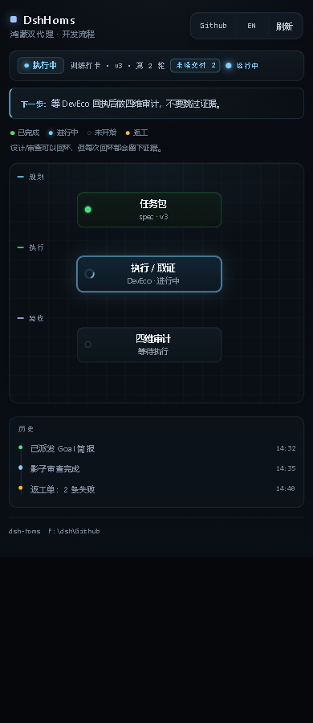

# DwGuard-Dsh-Hmos

[](https://github.com/Dogwind221/dwguard-dsh-hmos/actions/workflows/ci.yml)
[](LICENSE)
[](https://www.npmjs.com/package/dwguard-dsh-hmos)

A DeepSeek Harness (DSH) plugin for HarmonyOS app delivery: DSH plans, pre-reviews
and **audits**; DevEco Code implements. The two agents coordinate through a
small file protocol under `.shared/`, and every verdict must be backed by
evidence DSH gathered itself.

> 中文文档见 [README.md](README.md). Changelog: [CHANGELOG.md](CHANGELOG.md).

## Why it exists

Handing a feature to a coding agent and eyeballing the result does not scale.
This plugin makes the hand-off explicit:

- **Task pack** — requirements, spec, four-dimension acceptance criteria
  (function / aesthetic / performance / accessibility), constraints, version.
- **Pre-review** — an adversarial pass before dispatch; a blocker must carry an
  attempted rebuttal and must be closed before dispatch.
- **Independent audit** — four sub-agents (one per dimension) gather evidence;
  `dwguard_audit` refuses a pass unless every must criterion is covered, all four
  dimensions are assessed, no blocker/major is open, and evidence files exist
  (copied into the bundle with SHA-256).
- **Rework and confirmation** — a failed gate writes a rework order; a passing
  one writes the acceptance report and waits for an explicit user decision.
- **Calibration** — the plugin records every gate verdict and every later
  "this passed but the user found a bug", so the miss rate is measurable.
- **Design reference (0.6.2–0.7.0)** — `dwguard_design` recommends up to three
  directions, injects brand/principle/pattern rules into the brief, freezes an
  accepted paradigm pack only after a passed audit + user confirmation, and
  learns from pack feedback/benchmarks.

## Design reference loop

```text
requirement + module + brand colours
  → recommend (up to 3 directions)
  → user chooses
  → spec + design-brief
  → DevEco implements with ArkUI
  → four-dimension audit
  → dwguard_confirm
  → capture-pack (cards + pack.json + registry + optional preview)
  → next recommend prefers the accepted pack
```

The preview HTML is a visual reference only — not production code and not
acceptance evidence. Design cards/refs are contrast evidence, not criteria.

## Harness recovery (0.8.0)

- `dwguard_harness` persists checkpoints, attempts, last error and fallback in
  `.shared/harness/run.json`; `resume` checks specVersion/iteration, `retry` stops
  at `harnessMaxRetries`. `enqueue/queue/claim/complete/task-fail` use
  `.shared/harness/queue.json`; `scripts/harness-worker.mjs` can be scheduled by
  Windows Task Scheduler/cron so resume does not need a human to open a round.
- `dwguard_knowledge` searches 14 bundled SOPs and 32 engineering facts.
- `dwguard_deveco action:"pipeline"` runs sign → build → run → screenshot →
  layout with per-step evidence, stop-on-failure and optional resume. On
  `devecocli` failure it automatically tries the configured `deveco-mcp` tier,
  then `hdc+hvigor` (hdc screenshot/layout verified); every attempt is recorded.
- App-side AI (Intent/on-device models/in-app agents) is out of scope; a phone
  is not a development runtime. Multi-project runs isolate state in their own
  `.shared` and serialise device access via the existing device lock.

CLI/device verification and limits: [docs/0.8.0-verification.md](docs/0.8.0-verification.md) (Pura 90 emulator, not a physical phone).

## Security hardening (0.8.5)

0.8.5 fixes the six P0 findings from the 0.8.0 review. Some defaults are
intentionally breaking:

1. `strictEvidence` defaults to `true`; a must+pass needs `evidenceFiles` or a
   collector `observationRef`; self-report text is an error.
2. `actual` is structured (`value/unit/samples/aggregation`); free-text numeric
   extraction is gone, unit mismatches fail, and performance samples need
   `max/p95/mean`.
3. Matrix checks verify pool membership and family; matrix must+pass also requires
   a collector `observationRef`, which verifies the collector device and spec
   version.
4. State uses a lock + revision; dimension progress is split per
   `audit-progress/<specVersion>/<dimension>.json`; ids are reserved under a
   lock; every tool accepts `commandId` for idempotency.
5. Per-device leases (`token`, expiry, heartbeat); background jobs hold the
   lease for their whole lifetime; release must match the token.
6. Design packs validate name/path/realpath before any write; evidence files use
   collision-free names + `wx`; the board is loopback-only or `boardToken`,
   `cwd` must be a registered workspace, and paths are not returned.

See [docs/0.8.5-hardening.md](docs/0.8.5-hardening.md).

## Release/runtime hardening (0.8.6)

1. `publish.yml` runs `npm ci → typecheck → build → git diff --exit-code → test →
   tag/version check → npm pack check → publish`; `pretest` builds first.
2. Windows `cmd.exe` arguments reject `& | < > ^ % !` before quoting.
3. Screenshots must exist, be non-empty and carry PNG/JPEG magic; pipeline
   validates screenshot/layout artifacts, not just exit codes.
4. Child stdout/stderr are capped at 4MB; timeout/overflow kills the process tree.
5. Evidence paths are checked with `realpath`, not only string containment.
6. PNG decode bounds: 8192 per side, 32M pixels, 20MB IDAT, 160MB inflated;
   HTTP response bodies are capped at 4MB.
7. Embedding cache identity includes `provider + endpoint + model + modelVersion`.
8. Background `run/log` logs are checked every 5s and rotated to `output.log.1`
   + truncated above `maxDevecoLogBytes` (default 10MB).

## L4 evidence (0.8.7)

1. CI matrix: Ubuntu / Windows / macOS × Node 24 runs
   `npm ci → typecheck → build → git diff --exit-code → test → npm pack check`.
2. `npm run soak:100` runs the full suite 100 times sequentially with an isolated
   `DSH_HOME`; result: **100/100 rounds, 16,800 test executions, 0 failures**.
   Results land in `artifacts/soak/summary.json`.
3. This is **not** an L4 certification: real projects, physical devices, external
   audit and external adoption remain separate evidence.

## DshHoms visual (0.8.8)



Precision-console visual layer: grouped header controls, semantic phase bar,
next-action callout, grid-backed flow canvas, timeline history and mono data
type. Only the visual layer changed; workspace selection, dictionaries, refresh
interval, flow geometry, tools and audit logic are untouched. See
[docs/0.8.8-ui.md](docs/0.8.8-ui.md).

## Device/automation CLI (0.9.0)

```text
node bin/dwguard.mjs doctor   --workspace <project>
node bin/dwguard.mjs review   --workspace <project>
node bin/dwguard.mjs bridge   --workspace <project> --once
node bin/dwguard.mjs bench    --workspace <project> --faults
node bin/dwguard.mjs bench    --workspace <project> --device --require-physical
node bin/dwguard.mjs quickstart --dir <new-project> --api 24
```

`doctor` checks the toolchain/project/device; `review` recomputes evidence
hashes and acceptance consistency; `bridge` queues new DevEco deliveries for
`harness-worker`; `bench` covers fault cases and a device smoke test; no physical
device means `blocked` (exit 2), never a fake pass. The 10-minute walkthrough is
in [docs/quickstart-10min.md](docs/quickstart-10min.md).

## Design knowledge (0.9.4)

```powershell
node scripts/fetch-design-guide.mjs --concurrency 6
node scripts/search-design-guide.mjs "motion" --limit 5
node scripts/render-design-foundations.mjs
node --test tests/design-knowledge.test.mjs
```

`docs/design-guide/index.json` stores official URLs, markdown sha256, fetch date,
short summaries, outlines and rule references; `docs/design-resources/index.json`
is a link-only resource catalog with license/scope fields; and
`docs/design-foundations.json` / `.md` binds the beginner design checklist to
measurable `DW-AES-*` / `DW-A11Y-*` rules. No official bodies, images, icons or
templates are stored.

See [docs/0.8.6-hardening.md](docs/0.8.6-hardening.md).

## Install

npm package: [`dwguard-dsh-hmos`](https://www.npmjs.com/package/dwguard-dsh-hmos) (current 0.9.4).

> **0.9.4 adds design knowledge**: a citation/summary index of 167 official
> Huawei UX design documents (sha256 + fetch date; no bodies/images/assets),
> a link-only design-resource catalog, and a design-foundations checklist bound
> to `DW-AES-*` / `DW-A11Y-*`. Local only, not pushed.
>
> **0.9.2 aligns the 0.2.2 runtime peers**: `@deepseek-ai/cordis` is now
> `~4.0.5 || ~4.1.0`, `@deepseek-ai/schemastery` is `~3.18.5 || ~3.19.0`, and
> the dev dependency is pinned to `@deepseek-ai/dsh-tools@0.2.2-rc.1` with a
> typecheck/build/boot verification on that host. See
> [docs/0.9.2-runtime.md](docs/0.9.2-runtime.md).
>
> **0.9.1 fixes DSH Market compatibility**: the `@deepseek-ai/dsh-tools` peer
> is now `^0.2.1-rc.5` instead of an exact pin. DSH Market compares host-line
> peers against the running DSH version, so the exact pin was classified
> `aboveMax` on DSH `0.2.2-rc.1`. Marketplace listing is curated by
> `awesome-dsh-plugin`; npm publishing alone does not add a plugin. See
> [docs/0.9.1-market-compat.md](docs/0.9.1-market-compat.md).
>
> **0.9.0 adds device/automation foundations**: standalone `doctor`, evidence
> `review`, DevEco `bridge`, physical-device/fault benchmarks and a 10-minute
> quickstart. See [docs/0.9.0-plan.md](docs/0.9.0-plan.md) and
> [docs/quickstart-10min.md](docs/quickstart-10min.md).

### Install from npm

> **Installing the plugin is not `npm install`.** `npm install` only puts the
> package in `node_modules`; it does not register a DSH profile entry. Use DSH's
> plugin installer so the package is pulled from npm and registered:

| Entry | Command / action |
| --- | --- |
| Desktop app | **Plugins → Add plugin**, package `dwguard-dsh-hmos` (pin `dwguard-dsh-hmos@0.9.4`) |
| CLI profile | `dsh plugin --profile web add dwguard-dsh-hmos@0.9.4` |
| No `dsh` on PATH | `npx @deepseek-ai/dsh@0.2.2-rc.1 plugin --profile web add dwguard-dsh-hmos@0.9.4` |

Omit the version to follow the latest release.

The `desktop` profile is managed **exclusively by the desktop app** — the CLI
refuses `dsh plugin --profile desktop …`. Pick the path that matches how you run
DSH:

**Desktop app** — open **Plugins** in the left sidebar → **Add plugin** → enter
the package name `dwguard-dsh-hmos` (pin a version with `dwguard-dsh-hmos@0.9.4`)
→ install and choose the layer. *Install third-party plugin* in the same dialog
also takes a Git URL or a local directory. Restart DSH afterwards.

**CLI profiles** (`web` / `tui` / `headless` / custom) — `dsh plugin` forwards to
pnpm, so pnpm must be on `PATH`:

```powershell
dsh plugin --profile web add dwguard-dsh-hmos
dsh plugin --profile web add dwguard-dsh-hmos@0.9.4   # pin a version
# without a global dsh CLI:
npx @deepseek-ai/dsh@0.2.2-rc.1 plugin --profile web add dwguard-dsh-hmos
```

From GitHub or a local checkout (CLI profiles only):

```powershell
dsh plugin --profile web add .                                         # repo root
dsh plugin --profile web add https://github.com/Dogwind221/dwguard-dsh-hmos
```

Verify: `dsh --profile web --dump-config` should show `# == dwguard-dsh-hmos`.

Every **new** session then gets 16 tools, 4 skills and a policy prompt. Sessions
opened before the install keep their old tool table — open a new one.

## The `DshHoms` entry

A compact entry sits in the left sidebar between automation and plugins. It
opens a live board in the **right sidebar** without replacing the conversation:

- vertical flow, 规划 → 执行 → 验收, with parallel rows (coding beside the
  shadow reviewer, four audit sub-agent cards) and curved return edges;
- current stage spins, finished stages turn green, unstarted stages stay grey;
- history timeline under the map (prereview / dispatch / audit / rework / shadow
  / confirmation);
- **`中 / EN` toggle before refresh** (persisted, defaults to the host language);
  phase, next action and history switch together;
- `role="status"` announcements and reduced-motion support.

## Hybrid executor (0.3+, IDE-first)

`executor: auto` (default) keeps DevEco Code first. CLI only takes over when the
pack has **no visual `must` criterion** and the task is clearly batch /
regression / CI / refactor flavoured; a pack can pin `executor: ide | cli`.

In CLI mode, `tasks/cli-brief.md` gives an external CLI agent the
`devecocli build / run / run --apply / log` contract. DSH gathers build/log/device
evidence itself through **`dwguard_deveco`** (written to `artifacts/deveco-<n>/`);
`screenshot` / `layout` / `verify` call the real `devecocli ui` and
`devecocli verify` commands, `attach` registers an existing build log without
rebuilding, and `background: true` runs long builds detached (`jobs` / `stop`
manage them). A watchdog flags a dispatch with no ack/delivery after
`stallMinutes`, and `dwguard_status waitSeconds` long-polls for a delivery event.
Screenshots and the UI tree are still captured by DSH — the executor's
self-report never becomes a `pass`.

## Tools

| Tool | Purpose |
| --- | --- |
| `dwguard_spec` | Write / validate / read the task pack; criteria may carry a machine-checkable `assertion` (matcher + expected); scaffolds `.shared/` |
| `dwguard_prereview` | Record the adversarial pre-review (rebuttal required on blockers) |
| `dwguard_dispatch` | Generate the Goal-mode brief and the dispatch record (`cli-brief.md` in CLI mode) |
| `dwguard_scan` | Independent ArkTS/ArkUI static scan with stable rule IDs |
| `dwguard_deveco` | DevEco CLI evidence: `env / build / sign / run / log / lint / device / uiHelp / ui / screenshot / layout / a11y / verify / pipeline / attach / jobs / stop`; `pipeline` runs sign→build→run→screenshot→layout with per-step evidence, stop-on-failure, `resume` and automatic fallback; device actions use per-device leases (token/expiry/heartbeat) and background jobs hold theirs for their whole lifetime |
| `dwguard_shadow` | Read-only shadow review during execution (incremental, optional UI tree) |
| `dwguard_rules` | Query the rule catalog (`list`/`get`) and the local official-docs corpus (`search`) |
| `dwguard_audit_dimension` | Record one dimension as its sub-agent returns |
| `dwguard_audit` | Four-dimension audit; strict mode requires structured `evidenceFiles`/`observationRef` for must+pass, rejects self-report text, requires structured `actual` (unit/samples/aggregation), validates matrix pool/family and observation device/specVersion; a `profileRef` that is missing or `superseded` fails the gate; reports render the aesthetic-profile column and the baseline-diff section; evidence bundle; acceptance report or rework order |
| `dwguard_aesthetic` | Aesthetic learning (0.6.1) + cross-project templates (0.6.4): `profile`, `baseline`, `compare`, `learn`, `template` (list/get/export/import). Writes need `source` + `confidence`, changing an active value needs `confirmed: true`; `learn` only proposes unless `apply: true` **and** `confirmed: true`; `baseline save` needs a passing audit + user confirmation; `template import` needs `confirmed: true` (`merge` supersedes local conflicts) |
| `dwguard_design` | Design reference library (0.6.2–0.7.0): `library init/ingest/list`, `search` (filters incl. module/tone/density + `image` + `imageText` + `kind: principle`), `brief` (brand constraints / principles for direction / patterns for implementation), `recommend` (3 options), `capture-pack` (freeze after audit + confirmation, supports `supersedes`), `pack-feedback` (useful/off), `benchmark` (top-3 pack hit rate), `pack registry/export/import/migrate`, `feedback`, `capture`, `stats`. `hybrid` supports `openai`/`dashscope`; metadata includes `moduleTags`/`tone`/`density`/derived `colorProfile` and `preview`; `capture`/`capture-pack`/`pack import` need `confirmed: true` (capture-pack also needs audit + confirmation evidence); budgets hard-stop |
| `dwguard_harness` | Cross-session run journal + persistent queue: `status / checkpoint / resume / retry / fail / fallback / close` in `.shared/harness/run.json`; `enqueue / queue / claim / complete / task-fail` in `.shared/harness/queue.json`; `scripts/harness-worker.mjs` can be scheduled externally |
| `dwguard_calibration` | Gate accuracy ledger (`report` / `miss`) |
| `dwguard_confirm` | Record the user decision (`accept` / `new_round`) |
| `dwguard_knowledge` | `sediment` durable lessons; `sops` / `sop` search the 14 bundled SOPs; `engineering` searches 32 engineering facts |
| `dwguard_status` | Derive the phase, unread deliveries, un-acked dispatches, next action; shows host memory, device mode, matrix gaps and the device lock |

`dwguard_aesthetic` closes the aesthetic loop: a preference is proposed from
confirmed user wording or project resource files, the user picks between
conflicting values, and only then is it written to
`knowledge/aesthetic-profile.md`. A passing audit plus a user confirmation let
you save a visual baseline; `compare` then turns the next layout dump into
numeric diffs (±2vp for spacing/radius, zero tolerance for font size and
colours) that appear in the acceptance report.

`dwguard_design` (0.6.2–0.6.4) turns "what should it look like" into a shared,
retrievable asset: `library init` writes `.shared/design-library/` and a
dependency-free read-only `query.mjs`; `library ingest` seeds cards from the
aesthetic rule catalog and `inbox/*.meta.json` (incl. `stylePriority`,
`antiPatterns` (`AP-*`), `checklist`, `dimensions`, and brand cards; images are
copied into `refs/` by sha256); `search` ranks with deterministic BM25 plus
token/tag/profile boosts, filters by `appType` / `platform` / `style` / `kind`,
optionally reranks with an embedding endpoint (cached vectors, explicit lexical
fallback) or searches by image (pHash + RGB histogram) or by text→image when a
CLIP endpoint is configured. `brief` writes `tasks/design-brief.md` and appends an `inspiration` outbox
record; brand cards (`source.kind: brand`) are force-injected into a
「品牌与业务约束」 section; a failed aesthetic audit writes
`rework-suggestions.json` and the next brief carries 「上一轮返工定向参考」.
Aesthetic criteria/checks may carry `designRefs` and `antiPatternRefs`; referencing
a DSG card **auto-inherits that card's antiPatterns** into the audit checklist
(reports mark `inherited from DSG-…`), and the audit gate rejects missing/blocked
refs. `feedback` adjusts weight or hides cards; `capture` (after a passing
audit + user confirmation) stores the baseline as a project card; `pack
export/import` moves active cards + images between projects (fresh ids,
semantic dedupe). Per-round budgets (`maxAuditRounds`, `maxDesignSearches`)
hard-stop and are shown by
`dwguard_status`. DSH uses the tool; DevEco runs
`node .shared/design-library/query.mjs "dark card spacing" --top 5 --json` on the
same index (parity-tested).

## Protocol (`.shared/`)

```text
.shared/
├─ state.json                 # counters, cursor, confirmations
├─ outbox-dsh.md              # DSH → DevEco
├─ outbox-deveco.md           # DevEco → DSH
├─ tasks/
│  ├─ spec.md / spec.json     # frozen task pack
│  ├─ goal-brief.md           # brief to paste into DevEco Goal mode
│  ├─ design-brief.md         # design reference brief (0.6.2; dispatch references it)
│  ├─ rework-<n>.md           # rework order
│  └─ question.md             # executor questions
├─ artifacts/
│  ├─ audit-<n>.md|json       # audit records
│  ├─ audit-<n>/              # evidence bundle: manifest.json + evidence/
│  ├─ scan-<n>.json           # static scan
│  ├─ shadow-<n>.json         # shadow review
│  ├─ confirmation-<n>.json   # user decision
│  ├─ visual-baseline/<specVersion>/  # bounds JSON + screenshots (sha256 each)
│  ├─ aesthetic/compare-latest.json   # latest baseline diff (referenced by the report)
│  └─ acceptance-report.md
├─ design-library/            # 0.6.2–0.6.4: design references
│  ├─ manifest.json           # cards (DSG-* / AP-*) + counts
│  ├─ chunks.jsonl            # section text + sha256
│  ├─ index.json              # BM25 postings/df (rebuildable cache)
│  ├─ query.mjs               # dependency-free read-only CLI (lexical only)
│  ├─ feedback.jsonl          # useful / off / block / unblock ledger
│  ├─ rework-suggestions.json # queries from the last failed aesthetic audit
│  ├─ embeddings.json         # hybrid rerank vectors (model + sha256 keyed)
│  ├─ image-features.json     # pHash / histogram cache for image search
│  ├─ clip-embeddings.json    # CLIP image/text vectors (0.6.5)
│  ├─ refs/                   # images named by sha256
│  └─ inbox/                  # user drops <name>.png + <name>.meta.json
└─ knowledge/
   ├─ index.json
   ├─ calibration.jsonl       # gate ledger
   ├─ aesthetic-profile.md    # aesthetic profile (table + JSON line)
   ├─ aesthetic-history.jsonl # append-only applied / superseded / conflict
   └─ <topic>.md
```

Outbox records are append-only and carry an envelope:

```markdown
## [2026-11-01T10:00:00+08:00] dispatch · #d-1 · from=dsh to=deveco | Round 1 brief
## [2026-11-01T10:20:00+08:00] deliver · #a-1 · from=deveco to=dsh · re=#d-1 | Delivery
```

`kind` ∈ `dispatch | ack | deliver | question | answer | blocked | shadow-risk | rework | inspiration | design-request`.
A delivery without `re=#d-N` is not an acknowledgement; `dwguard_status` lists
un-acked dispatches for the current round.

## Rules and official docs

The catalog (`src/rules.ts`) has 75 rules with stable IDs and, where possible, a
`citation` pointing at the official page/section (Huawei UX standards, OpenHarmony
guides, AGC rejection checklist). `dwguard_spec` rejects unknown `ruleId`s;
findings cite the same IDs.

`dwguard_rules search` greps a local corpus (Huawei design docs and a sparse clone
of openharmony/docs). Set `docsDir` in the plugin config or `DWG_DOCS_DIR`:

```bash
node scripts/fetch-official-docs.mjs E:/harmony-docs --index=ux-design --match=contrast,touch
git clone --depth 1 --filter=blob:none --sparse https://github.com/openharmony/docs.git
```

## Config

```yaml
- id: dwguard-hmos
  config:
    sharedDir: .shared
    promptSection: true
    installSkills: true
    minCriteriaPerDimension: 1
    requireRebuttalOnBlocker: true
    requirePrereviewBeforeDispatch: true
    knowledgeMaxEntriesPerTopic: 200
    docsDir: ''
    shadowIntervalMinutes: 10
    stallMinutes: 30
    executor: auto         # auto = IDE-first | ide | cli
    devecocliPath: ''      # empty = auto-detect (PATH / npm global)
    hostMemoryGb: 0        # 0 = auto-detect; >0 = override (CI/containers)
    deviceMode: auto       # auto (by host memory) | single | matrix
    matrixMinMemoryGb: 32  # < 32GB forces single-device; >= 32GB allows the matrix
    deviceMatrix: [phone, widefold, foldable, triplefold]
    matrixScope: {}        # families per dimension; empty = defaults (function/perf phone, aesthetic/a11y all)
    allowMissingMatrixFamilies: false
    devicePool: []         # { sn, family, apiLevel, kind: emulator|real }
    maxConcurrency: 0      # 0 = auto by host memory (32GB -> 2, 64GB -> 4)
    deviceLockTimeoutMs: 600000
    designTopK: 5          # default design search size
    designMaxChunks: 2000  # warn above this chunk count
    designRanker: hybrid   # lexical (default) | hybrid (semantic recall + blend)
    designEmbeddingProvider: dashscope  # openai (compatible /embeddings) | dashscope (native contents)
    designEmbeddingEndpoint: ""  # dashscope: empty = official multimodal-embedding endpoint
    designEmbeddingModel: qwen3-vl-embedding  # one multimodal model for text + images; or tongyi-embedding-vision-flash
    designEmbeddingApiKeyEnv: DWG_DESIGN_EMBEDDING_KEY
    designEmbeddingTimeoutMs: 8000
    designEmbeddingWeight: 0.35
    designBriefCards: 5    # cards per tasks/design-brief.md
    designBrandCards: 3    # brand cards force-injected into every brief (0 = off)
    designPrincipleCards: 3  # principle cards in the brief's direction section
    maxAuditRounds: 5      # hard cap on audits per round
    maxDesignSearches: 12  # hard cap on design searches per round
    harnessMaxRetries: 3   # attempts per harness step before human decision
    strictEvidence: true   # must+pass needs structured evidence; self-report is an error
    boardToken: ""         # empty = loopback-only; otherwise x-dwguard-token is required
    designEmbeddingModelVersion: ""  # part of the embedding cache identity
    designClipModelVersion: ""       # part of the CLIP cache identity
    maxDevecoLogBytes: 10485760      # rotate/truncate background logs above this
    devecoMcpCommand: deveco-mcp  # fallback tier 2; empty = skip
    hdcPath: hdc                  # fallback tier 3 hdc
    hvigorPath: hvigorw           # fallback tier 3 hvigor
    aestheticTemplatesDir: ""  # empty = ~/.dsh/dwguard/aesthetic-templates
    designPacksDir: ""         # empty = ~/.dsh/dwguard/design-packs
    designClipProvider: dashscope  # custom (own contract) | dashscope (native contents)
    designClipEndpoint: ""     # dashscope: empty = official multimodal-embedding endpoint
    designClipModel: qwen3-vl-embedding   # or tongyi-embedding-vision-flash
    designClipApiKeyEnv: DWG_DESIGN_CLIP_KEY
    designClipTimeoutMs: 8000
    designClipWeight: 0.5      # semantic weight in image search (0–1)
    designLicenseRequired: true  # true = licence-unknown cards are excluded from search
```

**Device matrix (0.6.0)**: memory is auto-detected; `< 32GB` stays single-device
(16GB machines never start a matrix and get a warning if one is configured);
`>= 32GB` enables the Huawei screen-family matrix (phone / widefold / foldable /
triplefold). In matrix mode every `dwguard_audit` check must carry `device` +
`family`, and the gate refuses a missing family unless
`allowMissingMatrixFamilies: true` explicitly waives it.

## Boundaries

- DSH never edits application code; changes become findings, rework orders or a
  new task pack.
- The gate is hard: no "pass with open issues" switch.
- DSH may run build/run/log through `dwguard_deveco` as **evidence**, but never
  edits `entry/`, `AppScope/`, `hvigor/` or `build-profile.json5`; visual proof
  (screenshots, UI tree) is captured by DSH itself.
- State is derived from artifacts, not from tool claims.

## Development (source build & tests)

> `npm install` here is only for **source development/testing**, not for
> installing the plugin; see [Install](#install).

```bash
npm install       # typescript, @types/node, @deepseek-ai/dsh-tools, @deepseek-ai/schemastery
npm run typecheck
npm run build
npm test          # 180 tests (scripts/preflight.mjs checks the host test deps first)
node scripts/release.mjs --bump=patch --dry-run
```

`lib/` is committed build output, so installing from a clone does not require a
build. Rebuild it before committing source changes, and never keep `node_modules`
inside a linked install (it would shadow the host's `@deepseek-ai/dsh-tools`).

Releases publish from CI: `git tag vX.Y.Z && git push origin vX.Y.Z` runs
`publish.yml`, which authenticates with **npm trusted publishing (OIDC)** and
attaches a provenance statement — no `NPM_TOKEN` secret involved.

## License

MIT
