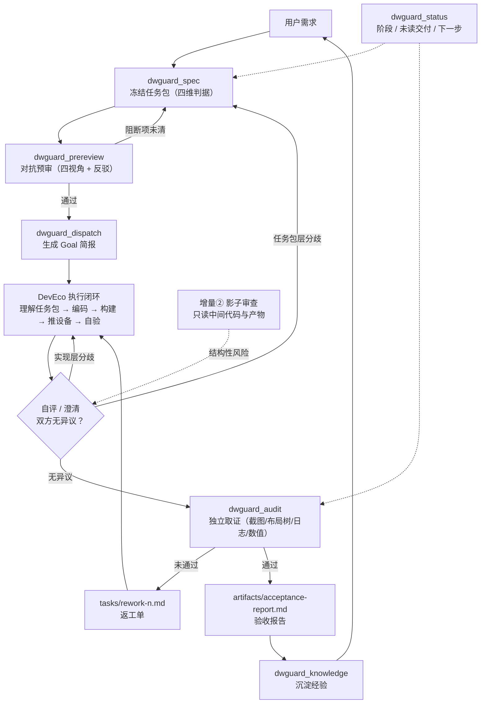

# DwGuard-Dsh-Hmos

**DSH 侧的鸿蒙双 Agent 编排与外部审计插件。** 它把「DSH 编排 + DevEco Code 执行」的协作方式，从一份提示词文档变成一组**有闸门的工程动作**：任务包冻结、派发前对抗预审、Goal 模式派发、四维外部审计、返工单、验收报告、知识沉淀。

核心主张只有一句：**交付物必须自己证明自己，DSH 不采信执行者的自述结论。**

> English: [README.en.md](README.en.md) · 变更记录：[CHANGELOG.md](CHANGELOG.md)

---

## 为什么需要它

让一个 Agent 自己写、自己测、自己说"完成了"，等于没有验收。这个插件把 DSH 的职责钉死在三件事上：

1. **先把"做完"定义清楚**：功能 / 审美 / 性能 / 无障碍四维判据，每条都必须可证伪、有独立验证方式。写不出来就不许派发。
2. **派发前先自我攻击**：从性能、生命周期、并发、API 兼容四个视角质询任务包，阻断项必须经历一次反驳尝试。
3. **交付后自己取证**：截图、布局树、日志、测量值，一条判据一段证据。四维没覆盖、must 判据没证据，闸门就不开。

---

## 架构



两个回环，不要混：

- **实现层**（Spec 没问题，是实现偏差）→ 回「编码实现」，出返工单/返工项；
- **任务包层**（Spec 歧义、判据不可达、架构方向错）→ 停线 → 改任务包、升版本 → **重跑预审** → 重新派发，执行者回到「理解任务包」；
- 影子审查（增量②）的结论先落到「自评 / 澄清」这个闸门：双方无异议才交付，有分歧先澄清再决定回哪一层。

与原始框架文档的四个增量一一对应：

| 文档中的增量 | 本插件里的落点 |
| --- | --- |
| ① 派发前架构预审 | `dwguard_prereview`（阻断项需 rebuttal，未关闭不得派发） |
| ② 并行影子审查者 | 编码期只读巡检 → 风险**分层**：任务包层停线改包重预审（回「理解任务包」），实现层记返工项（回「编码实现」）；`dwguard_status` 汇总 |
| ③ 外部审计（不采信自验） | `dwguard_audit`（逐条 `checks` + 独立证据 + 四维覆盖闸门；**四维各派一个子代理并行取证**） |
| ④ 知识沉淀 | `dwguard_knowledge`（按主题归档，索引去重） |

---

## 安装

要求：DSH `0.2.1-rc.x`（`engines.dsh: >=0.2.1-rc.0 <0.3.0`）。插件以 **bundle** 形式安装，注册一个 host 行。

**先确认你跑的是哪个 profile**——装错 profile 是"装了但看不到"最常见的原因：

| 启动方式 | profile |
| --- | --- |
| 桌面应用（`DeepSeek Harness.exe`，本文档的默认场景） | `desktop` |
| 命令行 `dsh web` | `web` |

```powershell
# 在仓库根目录执行（推荐；也可以把 . 换成仓库绝对路径）
dsh plugin --profile desktop add .
dsh plugin --profile web     add .

# 2) 确认组合层已生效（应看到 # == dwguard-dsh-hmos）
dsh --profile desktop --dump-config

# 3) 桌面版通常会被 HMR 热加载；没有的话重启应用（托盘里也要退出）
```

装好后，**任意会话**都会拿到 12 个工具、3 个 skill 和一段策略提示词。让 DSH「给鸿蒙做个 XX 页面」，它会自动加载 `dwguard-hmos` skill。已经打开的旧会话如果没热加载到新工具，新开一个会话即可（工具表在会话开始时就固定了）。

### 可选：独立的 Agent 预设

Bundle 已经全局注册，预设只是让新会话选择器里多一个「DwGuard 鸿蒙双代理」入口（工具集偏向编排与取证，不含实现类工具）：

```powershell
# 方式一：作为叠加层启动一次（桌面版把 web 换成 desktop；在仓库根目录执行）
dsh --profile web --patch "preset/dwguard-hmos.cordis.yml"

# 方式二：把 preset/dwguard-hmos.cordis.yml 里 - insert: 的整段粘贴进
#        %USERPROFILE%\.dsh\profiles\<desktop 或 web>\cordis.patch.yml，然后重启
```

预设依赖部署里有 `@deepseek-ai/dsh-agent-preset`（Web 版自带）。不想用就不装，工具照常可用。

### 卸载

```powershell
dsh plugin --profile desktop remove dwguard-dsh-hmos
dsh plugin --profile web     remove dwguard-dsh-hmos
```

---

## 界面入口：DshHoms（右侧栏看板）

侧边栏新增一行 **DshHoms**，位置在 **插件**（order 0）与 **自动化任务**（order 10）之间（本插件 order 5）。

**点它不会顶掉对话**：看板以标签页形式开在 **右侧栏**（tab 标题 `DshHoms`），主区域保持当前会话。左侧再点一次会复用已打开的标签，不会重复开。

点击路径有两条，因为右侧栏的 `openTab` 依赖「对话占据主列」时的会话 surface：

1. **点图标**：拦截侧栏行的点击（`stopPropagation`），直接 `openTab`，主区域完全不动；
2. **点行/文字**：行会先选中本插件在主区域的启动器面板——启动器在 `useLayoutEffect` 里立刻 `selectPanel(null)` 交还会话，再以 30ms 起、60ms 间隔重试 `openTab`（最多 ~1.5s），surface 挂载后打开。

因此不会出现「右侧栏打不开 / no session surface is mounted」——除非当前根本没有打开会话。

看板是一张**暗色竖向流程图**，最大宽度 640px、按右侧栏宽度自适应（`ResizeObserver` 实测，卡片随栏宽伸缩并保持居中，两侧留出画回退线的空间），从上到下 规划 → 执行 → 验收；**同一层的并行模块**也画在视图里：

- **打开就有图**：还没有任务包时，整张图以灰态展示、第一张卡待命——先让人看见流程，再让流程亮起来；
- **亮起来**：本轮开始后，当前模块的呼吸描边 + 卡片入场逐个浮起 + 该行一圈淡蓝光晕，顶部出现 `进行中` 呼吸点；
- **并行行**：`编码实现 ②` 与 `影子审查 ②` 并排；进入时一条线分叉（fork），离开时两条线合流（merge），两个模块各自有状态；
- **四维审计行**：`功能 / 审美 / 性能 / 无障碍` 四张子代理卡并排（栏宽 ≥560 时一行四列，更窄时 2×2）；每张卡显示自己的 `通过/总数`，**子代理回来一个就落绿一个**，没回来的继续转圈——状态来自 `artifacts/audit-progress.json`，不是"同时开始同时结束"的假动画；
- **进行中**：卡片左侧转圈 + 呼吸描边；指向**下一个模块**的连线有流动虚线；
- **返工**：闸门卡琥珀色，右栏回退线高亮并流动；
- **左栏（蓝/紫虚线，任务包层）**：预审不通过 → 生成任务包；澄清 Spec 有误 → 生成任务包；影子审查的结构性风险 → **理解任务包**；
- **右栏（琥珀虚线，实现层）**：自评有分歧 → 编码实现；审计返工 → 编码实现；
- **历史时间线**：图下方按时间倒序列出预审 / 派发 / 审计 / 返工 / 影子审查 / 用户确认，一眼看到这一轮怎么走到现在的；
- **语言与无障碍**：界面跟随宿主语言（`en` 字典已接，`zh` 兜底）；阶段变化用 `role="status"` 播报；系统开启「减少动态效果」时关闭转圈/光晕/流动动画。

执行段里有一张 **`自评 · 澄清 / 反馈`** 卡：DevEco 说「自认为达标」只是**声明**，不是交付。闸门只放三种结果：

| 情况 | 走向 |
| --- | --- |
| 双方无异议（影子风险已改、`question.md` 已答、结构没跑偏） | 交付 → 外部审计 |
| **实现层分歧**（代码写法/性能/生命周期不合规） | 回「编码实现」（右栏琥珀回退线） |
| **任务包层分歧**（Spec 歧义、判据不可达、方向错） | 回「生成任务包」→ 升版本 → **重跑预审** → 重新派发（执行者重新「理解任务包」） |

```text
 ┌ 规划 ──────────────────────────────────────────────
 │  ● 需求澄清
 │  ● 生成任务包 ◄───────────┐◄─────────────┐      判据 6 · must 5
 │  ● 派发前预审 ①            │              │
 │  ● 派发给 DevEco           │              │
 ├ 执行 ─────────────────────┼──────────────┼───────
 │  ● 理解任务包 ◄────────────┼──────────────┼──┐
 │  ┌──────────┐ ┌─────────┐  │              │  │
 │  │◉ 编码实现②│ │┄影子审查②│  │              │  │    ← 同行并行
 │  └────┬─────┘ └────┬────┘  │              │  │
 │       └─────┬──────┘       │              │  │
 │  ● 自评 · 澄清 / 反馈 ─────┘              │  │
 │  ● 交付结果                               │  │
 ├ 验收 ────────────────────────────────────┼──┼───
 │  四维外部审计 ③ · 4 个子代理并行取证        │  │
 │  ●功能  ●审美  ●性能  ●无障碍              │  │
 │  ● 审计闸门 ✓/✗ ──────────────────────────┘  │
 │  ● 知识沉淀 ④ → ○ 报告 → ○ 确认               │
 └──────────────────────────────────────────────┴──┘
   左栏：任务包层回退        右栏：实现层回退（返工）
```


阶段映射（由 `.shared/` 产物推导，不靠口头声明）：

| 阶段 | 进行中的节点 |
| --- | --- |
| `intake` | 需求澄清 |
| `spec` / `spec-invalid` | 生成任务包 |
| `prereview` | 派发前预审 |
| `ready` | 派发给 DevEco |
| `dispatched`（无未读） | 编码实现 **+ 影子审查**（同一行并行，两个 spinner） |
| `dispatched`（有未读交付） | 四张审计卡同时 active（4 个子代理并行取证） |
| `rework` | 编码实现 + 影子审查（闸门标琥珀，澄清/交付/审计保持已完成） |
| `accepted` | 知识沉淀（等待 `dwguard_confirm`） |
| `confirmed` | 整张图全绿、无 spinner（本轮已由用户确认） |

数据来自插件注册的只读接口 `GET /dwguard/board`（同源、无写入、`cache-control: no-store`）。工作区列表来自工具调用时记录的 `~/.dsh/dwguard/workspaces.json`——**先跑一次任意 DwGuard 工具，看板才有工作区可选**。

右侧栏是**按会话**的：没有打开的会话时，入口会提示「右侧栏打不开」，打开会话后再点即可。

| 组件 | 文件 |
| --- | --- |
| 侧边栏入口 + 右侧栏标签（浏览器模块，无构建步骤） | [lib/client.js](lib/client.js) |
| 看板接口 | [src/web.ts](src/web.ts) |
| 看板投影 | [src/board.ts](src/board.ts) |
| 工作区记录 | [src/workspaces.ts](src/workspaces.ts) |

> 入口与右侧栏标签在应用启动时装配：**改完需要完全退出 DSH 再打开**（托盘里也要退出）。若面板提示「看板接口不可用」，工具、Skill 与闸门仍然照常工作——只是实时看板读不到。

---

## 十二个工具

| 工具 | 阶段 | 作用 | 关键闸门 |
| --- | --- | --- | --- |
| `dwguard_spec` | 立项 → 任务包 | 写入 / 复检 / 查看任务包，首次调用会脚手架 `.shared/` | 四维至少各 1 条；拒绝纯形容词、缺验证方式、依赖自述的判据；`ruleId` 必须在规则目录内；至少 1 条 must |
| `dwguard_prereview` | 派发前预审 | 记录对抗审查发现 | 阻断项必须有 `rebuttal`；未关闭的阻断项不许派发；零发现必须写审阅范围 |
| `dwguard_dispatch` | 派发 | 生成 `tasks/goal-brief.md` 并写 `outbox-dsh.md` | 任务包合法 + 最近一次预审通过（可配置关闭） |
| `dwguard_scan` | 取证前 | 独立 ArkTS/ArkUI 静态扫描（只读）：嵌套属性赋值、`any`、`@ohos.*`、V1/V2 混用、伪包、ForEach、定时器、无障碍文本 | 每条命中带规则 ID 与 `file:line`；写 `artifacts/scan-<n>.json`；must 级要进审计 findings |
| `dwguard_shadow` | 执行期 | 影子审查：**增量扫描**（只看上次之后改过的文件），自动尝试调用宿主的 `harmony_ui_tree`（失败则需手动传 `uiTree`），写 `artifacts/shadow-<n>.json`；**只把新增**的 must 级风险写 `shadow-risk` 出站 | 只在 dispatched / rework 阶段可跑；`status` 超过 `shadowIntervalMinutes` 会提醒；同一问题不会重复刷屏 |
| `dwguard_rules` | 全程 | 查规则目录（`list` / `get`，支持别名）与本地官方语料（`search`，返回 file:line + 出处 URL） | 语料目录由 `docsDir` / `DWG_DOCS_DIR` 指定；`get` 未知 ID 直接报错 |
| `dwguard_audit_dimension` | 审计取证 | 单个维度子代理返回后立刻记录（`passed` / `failed` / `note`） | 写 `artifacts/audit-progress.json`；面板据此让四张卡**逐张落地**，而不是同时亮 |
| `dwguard_audit` | 外部审计 | 汇总逐条检查与发现，自动出返工单或验收报告 | must 全覆盖、四维全评估、无未关闭 blocker/major、失败项不许记成 unverified；证据文件缺失或**超过 20MB/份、100MB/包**整次拒绝；完成后清空进度文件；每次审计自动记账 |
| `dwguard_calibration` | 收尾 | 闸门准确率账本：`report` 算四维漏检率，`miss` 记录"审计通过但用户后来发现问题" | `miss` 必须针对已通过的审计；账本 `knowledge/calibration.jsonl` 只追加 |
| `dwguard_confirm` | 收尾 | 记录用户对验收报告的决定：`accept` 结束本轮，`new_round` 迭代号 +1 | 必须有通过的审计与 acceptance-report；写 `artifacts/confirmation-<n>.json` 并更新 state |
| `dwguard_knowledge` | 沉淀 | 追加到 `knowledge/<topic>.md` | 索引按 kind+结论去重 |
| `dwguard_status` | 全程 | 从产物反推阶段、未读交付、下一步 | 不改状态，只读 + 可选前移游标 |

每个工具都返回同一个信封：`{ ok, summary, detail, files, next }`。`detail` 是可直接展示的 Markdown；`next` 是唯一的下一步建议。

### 三个 Skill

| Skill | 内容 |
| --- | --- |
| `dwguard-hmos` | 七阶段编排协议、角色边界、10 条硬规则、反模式、第一轮启动顺序 |
| `hmos-acceptance-rubric` | 四维判据写法 + 规则库 `DW-FN/AES/PERF/A11Y` + 阈值 + 好/坏示例 |
| `hmos-audit-playbook` | hdc 截图/布局树/日志/性能采集命令、四维审计流程、假通过清单、6 个审计子代理提示词 |

Skill 正文在 `skills/*.md`，可以直接改；插件启动时按包内相对路径读取（读不到时回退到内置精简版，不影响加载）。

---

## `.shared/` 产物

首次 `dwguard_spec` 会创建：

```text
.shared/
├─ README.md                 # 协议说明（所有权 / 记录格式 / 阶段）
├─ state.json                # 计数器与未读游标
├─ outbox-dsh.md             # DSH → DevEco Code
├─ outbox-deveco.md          # DevEco Code → DSH（追加交付记录）
├─ tasks/
│  ├─ spec.md / spec.json    # 冻结的任务包
│  ├─ goal-brief.md          # 粘贴给 DevEco 的 Goal 简报
│  ├─ rework-<n>.md          # 返工单（审计未通过时）
│  └─ question.md            # 执行者的提问（需求真模糊时）
├─ artifacts/
│  ├─ prereview-<n>.md|json  # 预审记录
│  ├─ audit-<n>.md|json      # 审计记录
│  ├─ audit-<n>/             # 证据包：manifest.json + evidence/（每份带 sha256）
│  ├─ scan-<n>.json          # 独立静态扫描结果（规则 ID + file:line）
│  ├─ shadow-<n>.json        # 影子审查记录（含可选 UI 树摘要）
│  ├─ confirmation-<n>.json  # 用户确认记录（accept / new_round）
│  └─ acceptance-report.md   # 验收报告（通过时）
└─ knowledge/
   ├─ index.json             # 去重索引
   ├─ calibration.jsonl      # 闸门账本：审计/确认/漏检（每行一条）
   └─ <topic>.md             # 按主题沉淀
```

两个 outbox 都是**只追加**，每条记录以 `## [ISO 时间] <kind> · #<id> · from=… to=… · re=#<id> | 标题` 开头
（`kind` = `dispatch | ack | deliver | question | answer | blocked | shadow-risk | rework`），`dwguard_status`
用一个游标统计未读，并单独列出**发出但没回执**的 dispatch（没有 `re=#d-N` 的记录不算回执，v2 之前的老记录按 legacy 兼容）。

审计的 `checks[].evidenceFiles` 写**相对 `.shared/`** 的路径；工具会校验文件存在（否则整次审计不落盘）、复制进 `artifacts/audit-<n>/evidence/`，并在 `manifest.json` 里记 `sha256`。报告里的"证据"从此可复核：同一份字节、可校验哈希。

规则 ID 是任务包、静态扫描、审计三处的共同语言：`dwguard_spec` 的判据可带 `ruleId`（`DW-A11Y-02`、`STATE-NESTED-01`、`AGC-RJ-013` 等，目录外一律拒绝），`dwguard_scan` 的命中与 `dwguard_audit` 的 findings 用同一套 ID。

---

## DevEco Code 侧怎么配合

插件不驱动 DevEco Studio，它生成一份**自足**的简报：

1. DSH 调 `dwguard_dispatch`，返回的 `detail` 就是简报全文（同时写到 `tasks/goal-brief.md`）。
2. 你把它粘进 DevEco Code 的 Goal 模式。
3. DevEco 按简报里的「交付记录格式」把结果追加到 `outbox-deveco.md`。
4. DSH 用 `dwguard_status` 读交付，再自己取证审计。

简报里写死了角色、路径、逐条判据、约束、执行闭环、交付格式、提问协议与禁止事项——不需要在 DevEco 侧装任何东西。

---

## 配置

写在 `cordis.patch.yml` 里覆盖默认值（或用 `--patch`）：

```yaml
- id: dwguard-hmos
  config:
    sharedDir: .shared                    # 相对工作区，或绝对路径
    promptSection: true                   # 注册团队策略提示词片段
    installSkills: true                   # 注册三个 skill
    minCriteriaPerDimension: 1            # 每个维度最少判据数
    requireRebuttalOnBlocker: true        # 阻断项必须记录反驳尝试
    requirePrereviewBeforeDispatch: true  # 没有通过的预审不许派发
    knowledgeMaxEntriesPerTopic: 200      # 单主题知识条目提示阈值
    docsDir: ''                           # 官方语料目录；空 = 自动探测（DWG_DOCS_DIR 等）
    shadowIntervalMinutes: 10             # 影子审查多久没跑就在 status 里提醒
```

覆盖是**整段替换**（DSH 的补丁语义），所以要把想保留的字段一起写上。

---

## 设计取舍与边界

- **DSH 不写应用代码**：插件只写 `.shared/`；改代码必须变成返工单或预审发现。这条写在策略提示词、skill 和工具描述三处，减少越界。
- **闸门是硬的**：`must` 判据 `unverified`、四维缺一维、开放 blocker/major，都会让 `dwguard_audit` 返回 `ok:false` 并生成返工单。没有"带病通过"的开关。
- **证据不可代填**：`checks[].evidence` 只接受"怎么取的 + 取到了什么"；像"自测通过/已确认"这类自述会被警告。
- **不做自动截图**：设备型号、hdc 版本、API 版本差异太大，插件给出命令与取证清单（skill），由 DSH 在会话里执行，证据落盘。这样审计记录可复核。
- **不接管 DevEco**：跨进程驱动另一个 IDE 的 Agent 不稳定，文件协议 + 人工粘贴是当前最可靠的边界。
- **状态从产物反推**：`state.json` 只存计数器，阶段由 spec / prereview / audit 的存在与闸门结果推导，手改文件不会让状态失真。

---

## 与同类工具的对比

`dsh-collaboration`（多智能体套件）、`dsh-deveco`（`harmony_ui_tree` 结构化 UI 树）、
`harmonyos-ai-workspace` / `harmonyos-skills`（鸿蒙规则库）、`hmharness`（自进化运行时）
各自强在哪、我们差在哪、该借什么，见 [docs/benchmark-integrations.md](docs/benchmark-integrations.md)。
一句话：**它们提供工具、规则或运行时，只有我们提供交付闸门**；我们要补的是证据的客观性与规则库广度。

---

## 开发

`lib/` 是随仓库提交的构建产物，**使用插件不需要编译**。只有改 `src/` 时才需要重新构建并一起提交：

```powershell
# 编译（src → lib，strict TS）
npm run build

# 单元 + 集成测试（node:test）
npm test
```

编译只需要 `typescript` 与 `@types/node`（`src/dsh.d.ts` 自带 DSH 模块声明，不依赖 DSH 的类型包）：

```powershell
npm install --no-save typescript @types/node
```

测试会调用**真实的** `defineTool` 校验每个工具定义，所以还需要能解析 `@deepseek-ai/dsh-tools`。两种可选做法：

```powershell
# a) 从 npm 装同版本（需网络）
npm install --no-save @deepseek-ai/dsh-tools@0.2.1-rc.5 @deepseek-ai/schemastery@3.18.5

# b) 或 junction 到本机已有的 DSH node_modules（路径按实际安装调整）
New-Item -ItemType Directory -Force node_modules | Out-Null
New-Item -ItemType Junction -Path node_modules\@deepseek-ai `
  -Target "$env:LOCALAPPDATA\Programs\nodejs\node_modules\@deepseek-ai\dsh\node_modules\@deepseek-ai"
```

> 注意：以 link 方式装进 profile 时，**不要**在包内保留 `node_modules`——否则包内会解析到另一份 `@deepseek-ai/dsh-tools`，与宿主运行时混版本。测试完可以删掉。

CI 在 [`.github/workflows/ci.yml`](.github/workflows/ci.yml)：ubuntu + windows、Node 22，依次跑 `typecheck → build → test`。

发版：`npm run release:dry` 预览版本号，`npm run release -- --bump=minor` 更新 `package.json`、重建 `lib/` 并 `npm pack`；脚本**不会**自动 publish，打完包会打印 tag / publish 步骤。版本记录见 [CHANGELOG.md](CHANGELOG.md)。

验证顺序（与本次交付一致）：

1. `npm run build` 零错误；
2. `npm test` 全绿（39 个用例：闸门规则、spec 校验、完整工作流、逐维审计进度、证据包、静态扫描、规则目录、协议回执、影子审查与去重、UI 树自动抓取、用户确认、跨轮隔离、校准账本、看板历史、客户端装配、发布脚本、注册）；
3. `dsh --profile web --dump-config` 出现 `# == dwguard-dsh-hmos`；
4. 另起一个实例 `dsh --profile web --no-open --port 0` 真实加载，无 `dwguard` 相关失败；
5. 重启 GUI 后在会话里调 `dwguard_status` 验证。

---

## 许可

MIT
