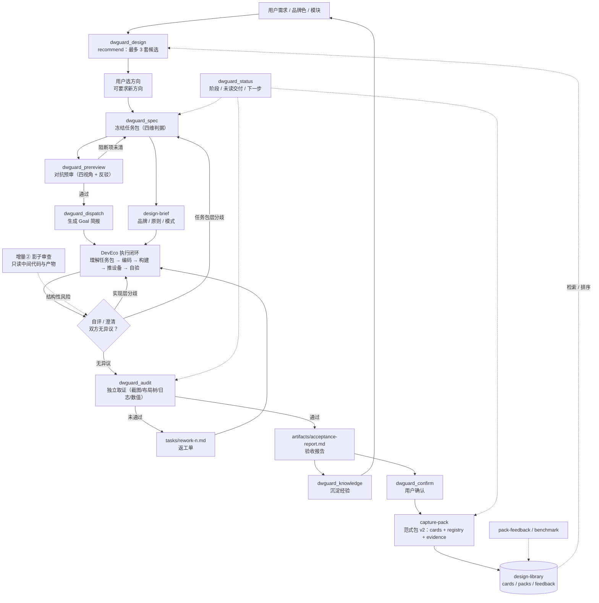
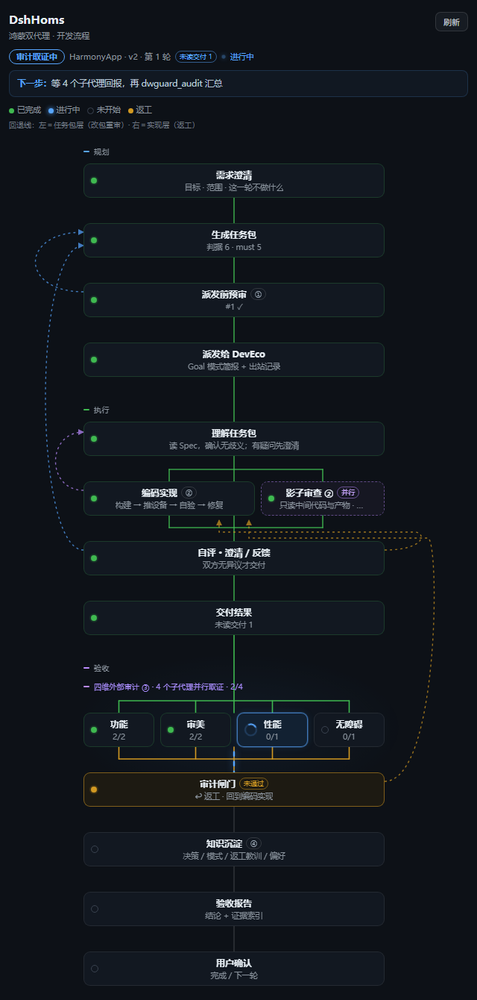
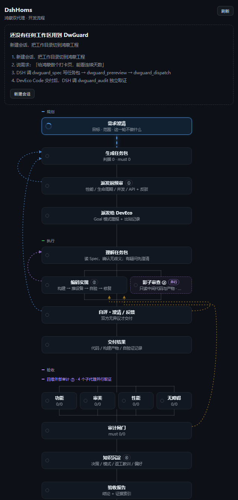
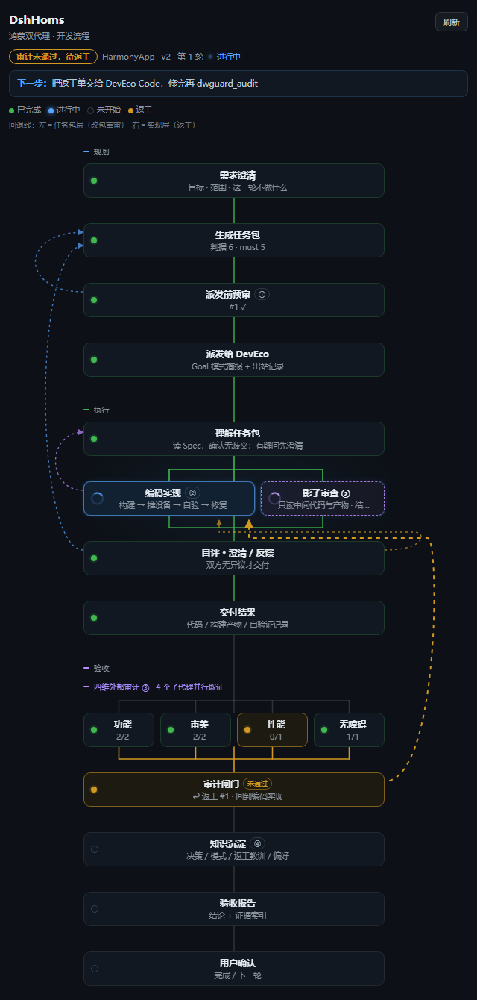
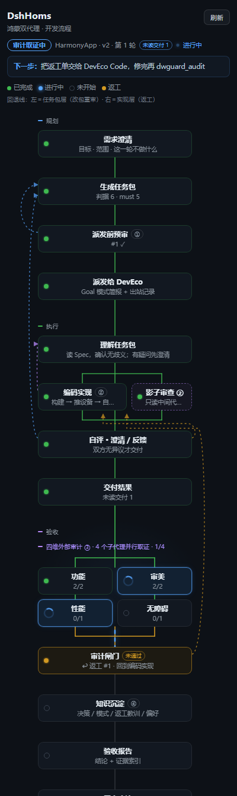
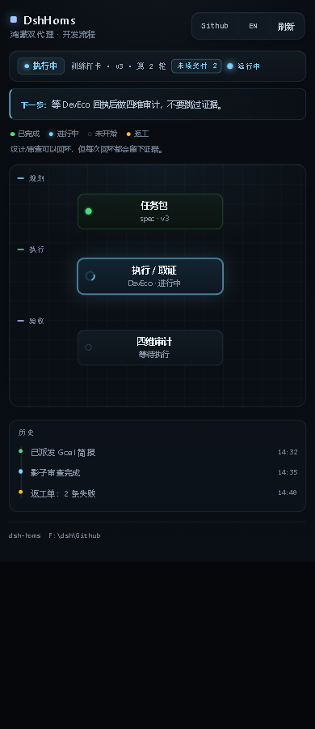

# DwGuard-Dsh-Hmos

[](https://github.com/Dogwind221/dwguard-dsh-hmos/actions/workflows/ci.yml)
[](LICENSE)
[](https://www.npmjs.com/package/dwguard-dsh-hmos)

**DSH 侧的鸿蒙双 Agent 编排与外部审计插件。** 它把「DSH 编排 + DevEco Code 执行」的协作方式，从一份提示词文档变成一组**有闸门的工程动作**：任务包冻结、派发前对抗预审、Goal 模式派发、四维外部审计、返工单、验收报告、知识沉淀。

0.6.2–0.7.0 在此之上加入**设计参考与范式包闭环**：`dwguard_design` 先 `recommend` 最多 3 套方向，`brief` 注入品牌/原则/模式；实现经四维审计 + 用户确认后 `capture-pack` 冻结范式包，`registry`/`supersedes`/`feedback`/`benchmark` 让下一轮推荐持续变好。

核心主张只有一句：**交付物必须自己证明自己，DSH 不采信执行者的自述结论。**

> English: [README.en.md](README.en.md) · 变更记录：[CHANGELOG.md](CHANGELOG.md)

---

## 为什么需要它

让一个 Agent 自己写、自己测、自己说"完成了"，等于没有验收。这个插件把 DSH 的职责钉死在三件事上：

1. **先把"做完"定义清楚**：功能 / 审美 / 性能 / 无障碍四维判据，每条都必须可证伪、有独立验证方式。写不出来就不许派发。
2. **派发前先自我攻击**：从性能、生命周期、并发、API 兼容四个视角质询任务包，阻断项必须经历一次反驳尝试。
3. **交付后自己取证**：截图、布局树、日志、测量值，一条判据一段证据。四维没覆盖、must 判据没证据，闸门就不开。

---

## 架构



主环仍是**四维验收**；设计参考层是旁路：`recommend` 给方向、`brief` 给规则，`capture-pack` 只在审计通过 + 用户确认后冻结范式包；`preview` 不是判据。

两个回环，不要混：

- **实现层**（Spec 没问题，是实现偏差）→ 回「编码实现」，出返工单/返工项；
- **任务包层**（Spec 歧义、判据不可达、架构方向错）→ 停线 → 改任务包、升版本 → **重跑预审** → 重新派发，执行者回到「理解任务包」；
- 影子审查（增量②）的结论先落到「自评 / 澄清」这个闸门：双方无异议才交付，有分歧先澄清再决定回哪一层。

与原始框架文档的四个增量一一对应：

| 文档中的增量 | 本插件里的落点 |
| --- | --- |
| ① 派发前架构预审 | `dwguard_prereview`（阻断项需 rebuttal，未关闭不得派发） |
| ② 并行影子审查者 | 编码期只读巡检 → 风险**分层**：任务包层停线改包重预审（回「理解任务包」），实现层记返工项（回「编码实现」）；`dwguard_status` 汇总 |
| ③ 外部审计（不采信自验） | `dwguard_audit`（逐条 `checks` + 独立证据 + 四维覆盖闸门；**四维各派一个子代理并行取证**） |
| ④ 知识沉淀 | `dwguard_knowledge`（按主题归档，索引去重） |

**0.6.2–0.7.0 新增设计参考层**（不在原始四增量内）：`dwguard_design` 先 `recommend` 最多 3 套方向，选定后 `brief` 注入品牌/原则/模式；实现经四维审计 + 用户确认后 `capture-pack` 冻结范式包；`registry`/`supersedes`/`pack-feedback`/`benchmark` 让下一轮推荐优先命中。它只提供方向与对照，不替代四维判据。

---

## 安装

要求：DSH `0.2.1-rc.x`（`engines.dsh: >=0.2.1-rc.0 <0.3.0`）。插件以 **bundle** 形式安装，注册一个 host 行。

npm 包：[`dwguard-dsh-hmos`](https://www.npmjs.com/package/dwguard-dsh-hmos)（当前 0.9.1）。

> **0.9.1 修复插件市场兼容性**：`@deepseek-ai/dsh-tools` peer 从精确版本改为 `^0.2.1-rc.5`，避免 DSH Market 在 DSH `0.2.2-rc.1` 上把插件误判为 `aboveMax`。市场收录由 `awesome-dsh-plugin` 策展，npm 发布本身不会自动出现在市场。根因与复核见 [docs/0.9.1-market-compat.md](docs/0.9.1-market-compat.md)。
>
> **0.9.0 是设备/自动回传/独立复核基础版**：`doctor`、`review` 证据复核、DevEco `bridge` 自动回传、物理设备/故障注入基准，以及十分钟 quickstart。详见 [docs/0.9.0-plan.md](docs/0.9.0-plan.md) 和 [docs/quickstart-10min.md](docs/quickstart-10min.md)。

### 从 npm 拉取（推荐）

> **注意：安装插件不是 `npm install`。** `npm install` 只会把包放进 `node_modules`，不会注册到 DSH 的 profile；正确入口是 DSH 的插件安装器，由它从 npm 拉取并注册。

| 入口 | 命令 / 操作 |
| --- | --- |
| 桌面版 | 侧栏 **插件 → 添加插件**，包名填 `dwguard-dsh-hmos`（固定版本 `dwguard-dsh-hmos@0.9.1`） |
| 命令行 profile | `dsh plugin --profile web add dwguard-dsh-hmos@0.9.1` |
| 没有 `dsh` 命令 | `npx @deepseek-ai/dsh@0.2.1-rc.5 plugin --profile web add dwguard-dsh-hmos@0.9.1` |

安装器会从 npm registry 解析版本；想跟最新版就省略版本号。下文分别说明桌面版与 CLI profile 的细节。

先确认你跑的是哪种入口——**`desktop` profile 由桌面应用独占管理，命令行改不了它**（`dsh plugin --profile desktop …` 会被明确拒绝），所以两种入口的安装方式不同：

| 启动方式 | profile | 安装入口 |
| --- | --- | --- |
| 桌面应用（`DeepSeek Harness.exe`，默认场景） | `desktop` | 侧栏 **插件 → 添加插件**（应用内） |
| 命令行 `dsh web` / `dsh tui` / `dsh headless` | `web` / `tui` / … | `dsh plugin --profile <name> add …` |

### 桌面版：应用内安装

1. 左侧栏打开 **插件** → 右上 **添加插件**；
2. 包名填 `dwguard-dsh-hmos`（固定版本就填 `dwguard-dsh-hmos@0.9.1`）→ 安装、选配置层、确认；
3. 装完按提示重启应用（托盘里也要退出）。

同一个对话框里的 **安装第三方插件** 也接受 Git 仓库地址和本地目录，所以「GitHub 直装 / 本地 checkout」在桌面版也走这里。

### 命令行 profile：CLI 安装

```powershell
# 需要在 PATH 上有 pnpm —— dsh plugin 会把参数转发给 pnpm
dsh plugin --profile web add dwguard-dsh-hmos

# 固定版本
dsh plugin --profile web add dwguard-dsh-hmos@0.9.1

# 机器上没有 dsh 命令时，用 npm 上的 CLI 包
npx @deepseek-ai/dsh@0.2.1-rc.5 plugin --profile web add dwguard-dsh-hmos
```

也可以从 GitHub 或本地目录装（同样只适用于命令行 profile）：

```powershell
# 在仓库根目录执行；把 . 换成绝对路径也可以
dsh plugin --profile web add .
dsh plugin --profile web add https://github.com/Dogwind221/dwguard-dsh-hmos
```

### 确认装好了

- 桌面版：**插件** 页出现 `DwGuard-Dsh-Hmos`；
- 命令行：`dsh --profile web --dump-config` 里能看到 `# == dwguard-dsh-hmos`。

装好后，**新开的会话**都会拿到 16 个工具、4 个 skill 和一段策略提示词。让 DSH「给鸿蒙做个 XX 页面」，它会自动加载 `dwguard-hmos` skill。已经打开的旧会话如果没热加载到新工具，新开一个会话即可（工具表在会话开始时就固定了）。

### 可选：独立的 Agent 预设

Bundle 已经全局注册，预设只是让新会话选择器里多一个「DwGuard 鸿蒙双代理」入口（工具集偏向编排与取证，不含实现类工具）：

```powershell
# 方式一：作为叠加层启动一次（命令行 profile；桌面版用方式二；在仓库根目录执行）
dsh --profile web --patch "preset/dwguard-hmos.cordis.yml"

# 方式二：把 preset/dwguard-hmos.cordis.yml 里 - insert: 的整段粘贴进
#        %USERPROFILE%\.dsh\profiles\<desktop 或 web>\cordis.patch.yml，然后重启
```

预设依赖部署里有 `@deepseek-ai/dsh-agent-preset`（Web 版自带）。不想用就不装，工具照常可用。

### 卸载

- 桌面版：**插件** → 已安装插件 → `DwGuard-Dsh-Hmos` → 移除；
- 命令行 profile：`dsh plugin --profile web remove dwguard-dsh-hmos`（`tui` 等换成对应 profile 名）。

---

## 界面入口：DshHoms（右侧栏看板）

侧边栏新增一行 **DshHoms**，位置在 **插件**（order 0）与 **自动化任务**（order 10）之间（本插件 order 5）。

**点它不会顶掉对话**：看板以标签页形式开在 **右侧栏**（tab 标题 `DshHoms`），主区域保持当前会话。左侧再点一次会复用已打开的标签，不会重复开。

点击路径有两条，因为右侧栏的 `openTab` 依赖「对话占据主列」时的会话 surface：

1. **点图标**：拦截侧栏行的点击（`stopPropagation`），直接 `openTab`，主区域完全不动；
2. **点行/文字**：行会先选中本插件在主区域的启动器面板——启动器在 `useLayoutEffect` 里立刻 `selectPanel(null)` 交还会话，再以 30ms 起、60ms 间隔重试 `openTab`（最多 ~1.5s），surface 挂载后打开。

因此不会出现「右侧栏打不开 / no session surface is mounted」——除非当前根本没有打开会话。

看板是一张**暗色竖向流程图**，最大宽度 640px、按右侧栏宽度自适应（`ResizeObserver` 实测，卡片随栏宽伸缩并保持居中，两侧留出画回退线的空间），从上到下 规划 → 执行 → 验收；**同一层的并行模块**也画在视图里：

- **打开就有图**：还没有任务包时，整张图以灰态展示、第一张卡待命——先让人看见流程，再让流程亮起来；
- **亮起来**：本轮开始后，当前模块的呼吸描边 + 卡片入场逐个浮起 + 该行一圈淡蓝光晕，顶部出现 `进行中` 呼吸点；
- **并行行**：`编码实现 ②` 与 `影子审查 ②` 并排；进入时一条线分叉（fork），离开时两条线合流（merge），两个模块各自有状态；
- **四维审计行**：`功能 / 审美 / 性能 / 无障碍` 四张子代理卡并排（栏宽 ≥560 时一行四列，更窄时 2×2）；每张卡显示自己的 `通过/总数`，**子代理回来一个就落绿一个**，没回来的继续转圈——状态来自 `artifacts/audit-progress.json`，不是"同时开始同时结束"的假动画；
- **进行中**：卡片左侧转圈 + 呼吸描边；指向**下一个模块**的连线有流动虚线；
- **返工**：闸门卡琥珀色，右栏回退线高亮并流动；
- **左栏（蓝/紫虚线，任务包层）**：预审不通过 → 生成任务包；澄清 Spec 有误 → 生成任务包；影子审查的结构性风险 → **理解任务包**；
- **右栏（琥珀虚线，实现层）**：自评有分歧 → 编码实现；审计返工 → 编码实现；
- **历史时间线**：图下方按时间倒序列出预审 / 派发 / 审计 / 返工 / 影子审查 / 用户确认，一眼看到这一轮怎么走到现在的；
- **语言与无障碍**：**刷新左侧有 `中 / EN` 切换**（localStorage 记忆，阶段 / 下一步 / 历史一起切）；可跟随宿主语言；阶段变化用 `role="status"` 播报；系统开启「减少动态效果」时关闭转圈/光晕/流动动画。

执行段里有一张 **`自评 · 澄清 / 反馈`** 卡：DevEco 说「自认为达标」只是**声明**，不是交付。闸门只放三种结果：

| 情况 | 走向 |
| --- | --- |
| 双方无异议（影子风险已改、`question.md` 已答、结构没跑偏） | 交付 → 外部审计 |
| **实现层分歧**（代码写法/性能/生命周期不合规） | 回「编码实现」（右栏琥珀回退线） |
| **任务包层分歧**（Spec 歧义、判据不可达、方向错） | 回「生成任务包」→ 升版本 → **重跑预审** → 重新派发（执行者重新「理解任务包」） |

```text
 ┌ 规划 ──────────────────────────────────────────────
 │  ● 需求澄清
 │  ● 生成任务包 ◄───────────┐◄─────────────┐      判据 6 · must 5
 │  ● 派发前预审 ①            │              │
 │  ● 派发给 DevEco           │              │
 ├ 执行 ─────────────────────┼──────────────┼───────
 │  ● 理解任务包 ◄────────────┼──────────────┼──┐
 │  ┌──────────┐ ┌─────────┐  │              │  │
 │  │◉ 编码实现②│ │┄影子审查②│  │              │  │    ← 同行并行
 │  └────┬─────┘ └────┬────┘  │              │  │
 │       └─────┬──────┘       │              │  │
 │  ● 自评 · 澄清 / 反馈 ─────┘              │  │
 │  ● 交付结果                               │  │
 ├ 验收 ────────────────────────────────────┼──┼───
 │  四维外部审计 ③ · 4 个子代理并行取证        │  │
 │  ●功能  ●审美  ●性能  ●无障碍              │  │
 │  ● 审计闸门 ✓/✗ ──────────────────────────┘  │
 │  ● 知识沉淀 ④ → ○ 报告 → ○ 确认               │
 └──────────────────────────────────────────────┴──┘
   左栏：任务包层回退        右栏：实现层回退（返工）
```

这张 ASCII 图只画**验收主环**；设计参考层是旁路：`recommend` → `design-brief` → 四维审计 + 用户确认 → `capture-pack`，不改变主环的闸门顺序。下图是 DshHoms 审计中的实际看板，同样只展示验收主环。






阶段映射（由 `.shared/` 产物推导，不靠口头声明）：

| 阶段 | 进行中的节点 |
| --- | --- |
| `intake` | 需求澄清 |
| `spec` / `spec-invalid` | 生成任务包 |
| `prereview` | 派发前预审 |
| `ready` | 派发给 DevEco |
| `dispatched`（无未读） | 编码实现 **+ 影子审查**（同一行并行，两个 spinner） |
| `dispatched`（有未读交付） | 四张审计卡同时 active（4 个子代理并行取证） |
| `rework` | 编码实现 + 影子审查（闸门标琥珀，澄清/交付/审计保持已完成） |
| `accepted` | 知识沉淀（等待 `dwguard_confirm`） |
| `confirmed` | 整张图全绿、无 spinner（本轮已由用户确认） |

数据来自插件注册的只读接口 `GET /dwguard/board`（同源、无写入、`cache-control: no-store`）。工作区列表来自工具调用时记录的 `~/.dsh/dwguard/workspaces.json`——**先跑一次任意 DwGuard 工具，看板才有工作区可选**。

右侧栏是**按会话**的：没有打开的会话时，入口会提示「右侧栏打不开」，打开会话后再点即可。

| 组件 | 文件 |
| --- | --- |
| 侧边栏入口 + 右侧栏标签（浏览器模块，无构建步骤） | [lib/client.js](lib/client.js) |
| 看板接口 | [src/web.ts](src/web.ts) |
| 看板投影 | [src/board.ts](src/board.ts) |
| 工作区记录 | [src/workspaces.ts](src/workspaces.ts) |

> 入口与右侧栏标签在应用启动时装配：**改完需要完全退出 DSH 再打开**（托盘里也要退出）。若面板提示「看板接口不可用」，工具、Skill 与闸门仍然照常工作——只是实时看板读不到。

---

## 十六个工具

| 工具 | 阶段 | 作用 | 关键闸门 |
| --- | --- | --- | --- |
| `dwguard_spec` | 立项 → 任务包 | 写入 / 复检 / 查看任务包，首次调用会脚手架 `.shared/` | 四维至少各 1 条；拒绝纯形容词、缺验证方式、依赖自述的判据；`ruleId` 必须在规则目录内；至少 1 条 must；判据可带 `assertion`（matcher + 期望值），非法断言写入前直接拒绝 |
| `dwguard_prereview` | 派发前预审 | 记录对抗审查发现 | 阻断项必须有 `rebuttal`；未关闭的阻断项不许派发；零发现必须写审阅范围 |
| `dwguard_dispatch` | 派发 | 生成 `tasks/goal-brief.md` 并写 `outbox-dsh.md`；`executor: cli` 时另写 `tasks/cli-brief.md` | 任务包合法 + 最近一次预审通过（可配置关闭） |
| `dwguard_deveco` | 执行期 / 取证 | 调 DevEco CLI 取证：`env / build / sign / run / log / lint / device / uiHelp / ui / screenshot / layout / a11y / verify / pipeline / attach / jobs / stop`；`pipeline` 顺序跑 sign→build→run→screenshot→layout，逐步落 `pipeline.json`，失败即停、支持 `resume` 与自动 fallback；命令、退出码与输出落到 `artifacts/deveco-<n>/`；截图落 `artifacts/devshots/`，布局树落 `layout.json`；设备动作使用每设备 lease（token/过期/心跳），后台任务全生命周期持锁 | 只跑固定子命令；超时/找不到 `devecocli` 明确失败；`ui` 参数按白名单校验；pipeline 只是执行证据，不替代 audit |
| `dwguard_scan` | 取证前 | 独立 ArkTS/ArkUI 静态扫描（只读）：嵌套属性赋值、`any`、`@ohos.*`、V1/V2 混用、伪包、ForEach、定时器、无障碍文本 | 每条命中带规则 ID 与 `file:line`；写 `artifacts/scan-<n>.json`；must 级要进审计 findings |
| `dwguard_shadow` | 执行期 | 影子审查：**增量扫描**（只看上次之后改过的文件），自动尝试调用宿主的 `harmony_ui_tree`（失败则需手动传 `uiTree`），写 `artifacts/shadow-<n>.json`；**只把新增**的 must 级风险写 `shadow-risk` 出站 | 只在 dispatched / rework 阶段可跑；`status` 超过 `shadowIntervalMinutes` 会提醒；同一问题不会重复刷屏 |
| `dwguard_rules` | 全程 | 查规则目录（`list` / `get`，支持别名）与本地官方语料（`search`，返回 file:line + 出处 URL） | 语料目录由 `docsDir` / `DWG_DOCS_DIR` 指定；`get` 未知 ID 直接报错 |
| `dwguard_audit_dimension` | 审计取证 | 单个维度子代理返回后立刻记录（`passed` / `failed` / `note`） | 写 `artifacts/audit-progress.json`；面板据此让四张卡**逐张落地**，而不是同时亮 |
| `dwguard_audit` | 外部审计 | 汇总逐条检查与发现，自动出返工单或验收报告 | must 全覆盖、四维全评估、无未关闭 blocker/major、失败项不许记成 unverified；`strictEvidence` 下 must+pass 必须有 `evidenceFiles`/`observationRef`，自述直接 error；带 `assertion` 的判据必须给结构化 `actual`（value/unit/samples/aggregation），单位不匹配拒绝；matrix 模式校验 `device` 属于 devicePool 且屏幕族一致；`observationRef` 校验设备与 specVersion；证据文件缺失或**超过 20MB/份、100MB/包**整次拒绝；完成后清空进度文件；每次审计自动记账 |
| `dwguard_aesthetic` | 审美学习（0.6.1–0.6.4） | `profile`、`baseline`、`compare`、`learn`、`template`（list/get/export/import 跨项目审美模板） | 写档案必须带 `source` + `confidence`，改已有领域的值需 `confirmed: true`；`learn` 默认只提议不落盘，`apply` 必须 `confirmed: true`；`baseline save` 必须有通过审计 + 用户确认；`template import` 必须 `confirmed: true`（merge 会 supersede 本地冲突） |
| `dwguard_design` | 设计参考库（0.6.2–0.7.0） | `library init/ingest/list`、`search`（关键词 + 维度/模块/气质/密度过滤 + `image` 以图搜图 + `imageText` 多模态文本→图 + `kind: principle`）、`brief`（品牌/原则/模式三通道）、`recommend`（3 套候选）、`capture-pack`（审计通过 + 用户确认后冻结范式包，支持 `supersedes`）、`pack-feedback`（包级 useful/off）、`benchmark`（top-3 包命中率）、`pack registry/export/import/migrate`、`feedback`、`capture`、`stats` | 默认 `lexical` 零网络；`hybrid` 支持 `openai`/`dashscope` provider；原则卡必须有 `proxies`/`checklist`；`preview` 只是视觉参考；`capture`/`capture-pack`/`pack import` 必须 `confirmed: true`（capture-pack 还需四维审计通过 + 用户确认记录）；检索/审计轮次受预算硬停 |
| `dwguard_harness` | 恢复 / 长任务 | 跨会话 journal：`status / checkpoint / resume / retry / fail / fallback / close`，写 `.shared/harness/run.json`；持久队列：`enqueue / queue / claim / complete / task-fail`，写 `.shared/harness/queue.json`；`scripts/harness-worker.mjs` 可由 OS 调度器定时领取 | 不改写验收判据；App 侧 AI 不在范围；跨机器分布式状态不适用 |
| `dwguard_calibration` | 收尾 | 闸门准确率账本：`report` 算四维漏检率，`miss` 记录"审计通过但用户后来发现问题" | `miss` 必须针对已通过的审计；账本 `knowledge/calibration.jsonl` 只追加 |
| `dwguard_confirm` | 收尾 | 记录用户对验收报告的决定：`accept` 结束本轮，`new_round` 迭代号 +1 | 必须有通过的审计与 acceptance-report；写 `artifacts/confirmation-<n>.json` 并更新 state |
| `dwguard_knowledge` | 沉淀 / 知识 | `sediment` 追加经验；`sops`/`sop` 检索 14 个 SOP；`engineering` 检索 32 条工程知识 | 索引按 kind+结论去重；SOP/知识只做输入，不替代判据 |
| `dwguard_status` | 全程 | 从产物反推阶段、未读交付、下一步；显示主机内存、单机/矩阵模式、屏幕族缺口与当前设备锁 | 不改状态，只读 + 可选前移游标 |

每个工具都返回同一个信封：`{ ok, summary, detail, files, next }`。`detail` 是可直接展示的 Markdown；`next` 是唯一的下一步建议。

规则来源与"官方文档还没学什么"分开记录：[docs/rule-sources.md](docs/rule-sources.md)（已引用出处）与 [docs/learning-backlog.md](docs/learning-backlog.md)（未覆盖清单 + 0.4 优先顺序）。0.4.0 范围与验收见 [docs/0.4.0-plan.md](docs/0.4.0-plan.md)。

### 审美学习（0.6.1）

审美判据不再每轮重新争论：

1. `dwguard_aesthetic` 的 `learn` 从用户确认/驳回、审计发现、校准漏检与项目 `resources/base/element/color.json` / `float.json` 里**确定性抽取**偏好（间距/圆角/字号/配色/动效/深色/图标/卡片），默认只返回提议与冲突，不写档案；
2. 用户裁决后带 `apply: true` + `confirmed: true`（多领域冲突用 `choices` 逐个指定，单 `choice` 有歧义会被拒绝）写入 `knowledge/aesthetic-profile.md`，历史追加到 `aesthetic-history.jsonl`，旧值标 `superseded` 而不删除；
3. `dwguard_spec` 的审美判据可带 `profileRef: "AES-RADIUS-01"`；`dwguard_audit` 校验引用存在且 active，并在审计/验收报告里渲染「审美档案」列；
4. 通过审计 + 用户确认后可用 `baseline save` 存视觉基线；下一轮用 `compare` 做数值回归（间距/圆角 ±2vp，字号/颜色 0 容差），差异自动进验收报告的「审美基线差异」小节。

### 设计参考库（0.6.2–0.7.0）

`dwguard_design` 把「参考什么」变成可检索、可追溯、两个 Agent 都能读的资产：

1. **建库**：`library init` 写 `.shared/design-library/`（manifest / chunks / index）并生成零依赖只读 `query.mjs`；
2. **摄取**：`library ingest` 从审美规则目录播种卡片，也可以吃 `inbox/<name>.meta.json`（title / tags / tokens / stylePriority / antiPatterns / checklist / dimensions / brand / source / license；0.6.8 起还有 `moduleTags` / `tone` / `density` / `preview`，`colorProfile` 从 palette 自动推导；图片会按 sha256 复制进 `refs/`）；
3. **检索**：确定性 BM25（中文 bigram + 同义词表）+ token/tag 精确加权 + 审美档案领域加成；可用 `appType` / `platform` / `style` / `module` / `tone` / `density` / `kind` 过滤（默认只返回 pattern）；`hybrid` 先做 **语义召回**（全卡向量 top-30）再与 BM25 候选并集融合，零字面重合也能命中；`search` 支持 `image`（pHash + 颜色直方图）与 `imageText`（多模态文本→图）；
4. **简报与问答**：`brief` 按任务包生成 `tasks/design-brief.md` 并写 `inspiration` 回执；**品牌卡（`source.kind: brand`）强制注入**「品牌与业务约束」小节；DevEco 可写 `design-request` 请求补充，DSH 用 `brief request: "q-1"` 应答；`dwguard_dispatch` 会自动生成并引用简报；
5. **闸门与报告**：审美判据/检查可带 `designRefs`（`DSG-*`）与 `antiPatternRefs`（`AP-*`）；引用 DSG 卡时**卡上的 antiPatterns 自动进入审计清单**（0.6.5，报告标「继承 DSG-xxxx」）；spec 写入时校验存在且 active，审计闸门拒绝缺失/blocked 引用，报告输出「参考对照」「反模式对照」列；
6. **返工检索桥（0.6.3 F）**：审计失败时按未通过的审美判据写 `rework-suggestions.json`，返工单给出建议检索词与参考；下一轮 `brief` 自动带入「上一轮返工定向参考」，审计通过后清空；
7. **预算（0.6.3 C）**：`maxAuditRounds` / `maxDesignSearches` 本轮上限，`dwguard_status` 显示「本轮预算」，用尽即硬停；
8. **反馈与捕获**：`feedback`（useful / off / block / unblock）调整权重或隐藏卡片；通过审计 + 用户确认后 `capture` 把视觉基线存成 `project` 卡，下一轮可直接命中；
9. **以图搜图（0.6.4）**：`search image: "artifacts/query.png"` 在 `.shared/` 内取 PNG，零依赖解码后算 64-bit DCT pHash + 4×4×4 颜色直方图，按 `0.6×pHash + 0.4×直方图` 排序；卡片图片特征缓存在 `image-features.json`，坏图/越界路径直接拒绝；
10. **跨项目模板（0.6.4）**：`dwguard_aesthetic template export/import` 把 active 审美档案存到全局目录（默认 `~/.dsh/dwguard/aesthetic-templates`）；import 必须 `confirmed: true`，merge 会 supersede 本地冲突；
11. **多模态 embedding（0.6.5–0.6.6）**：`designClipProvider: "dashscope"` 时走 DashScope 原生 `multimodal-embedding` 端点，`qwen3-vl-embedding` / `tongyi-embedding-vision-flash` **同一个模型同时给文本和图片出向量**；`search image` 把 pHash 与语义分融合（`designClipWeight`），`search imageText: "红色海报"` 直接文本→图；向量缓存在 `clip-embeddings.json`，失败时以图搜图回退 pHash、文本→图明确报错；
12. **卡片包（0.6.5–0.7.0）**：`pack export/import` 把 active 卡片（含图片）打包到全局 `designPacksDir`；v2 包同时写 inbox 兼容 `cards/*.meta.json`；import 需 `confirmed: true`，自动重映射 id、按语义去重、复制并重写 preview 路径；
13. **推荐与冻结（0.6.8）**：`recommend` 按需求/模块/气质/密度/品牌色给最多 3 套候选（含 tokens、为什么、代价、preview），写 `tasks/design-options.md` + `recommendations.json`；用户选定并实现后，**四维审计通过 + `dwguard_confirm` 记录**，再 `capture-pack choice:"opt-1" name:"..." confirmed:true` 冻结到 `.shared/design-packs/<name>/`（README.md + inbox 兼容 `cards/*.meta.json` + pack.json + 可选 preview），并向设计库追加一张 `范式包` 卡（带 `packRef`/`componentIds`），下一轮推荐优先考虑。没有审计/确认时 capture-pack 拒绝；
14. **范式包生命周期（0.7.0）**：`pack registry` 看 `.shared/design-packs/index.json`（status / supersedes / feedback）；`capture-pack supersedes:"old"` 标记旧包 superseded 并 block 其学习卡；`pack migrate` 把 v1 包升到 v2（无证据仍为 draft）；`pack-feedback` 用 useful/off 直接调包排序与学习卡权重；`benchmark` 读 `.shared/design-library/benchmarks/recommend.json` 输出 top-3 包命中率到 `artifacts/recommend-benchmark.md`；
15. **两个读者**：DSH 用 `dwguard_design`；DevEco 在 IDE 终端直接跑
   `node .shared/design-library/query.mjs "深色 卡片 间距" --top 5 --json`（支持 `--app-type` / `--platform` / `--style` / `--kind`），词法排序与工具 parity；hybrid、以图搜图、多模态、recommend 只在 DSH 侧（CLI 无端点/凭据/创作上下文），以简报/工具结果为准。

**principle 卡（0.6.7）**：`kind: "principle"`（`PR-*`）把传统艺术/奖项的抽象审美变成方向卡，必须有 `principle` + 至少一个 `proxies`/`checklist`，并写清 `misuses`；`brief` 新增「0.2 设计原则（方向）」通道（pattern 仍负责实现），审美判据可用 `principleRefs` 做「原则对照」——只校验引用完整性，不把原则文本本身当硬判据。

**推荐闭环（0.6.8–0.7.0）**：卡片新增 `moduleTags` / `tone` / `density` / 自动推导的 `colorProfile` 与 `preview`；`recommend` 输出 3 套可解释候选（不是“唯一最佳”）。用户选定并实现后，必须**四维审计通过 + `dwguard_confirm` 记录**，`capture-pack` 才能冻结为范式包；包内 `cards/*.meta.json` 是 inbox 兼容格式，可直接投回空库 re-ingest；`pack.json` v2 带审计/确认哈希、角色与适用维度；同时写回一张 `范式包` 卡供下一轮推荐。0.7.0 再加独立 `index.json` registry、`supersedes`、v1→v2 `pack migrate`、import preview 重写、`pack-feedback` 包级 useful/off 与 `benchmark` top-3 命中率。`.md` 是给 DevEco 的表达层，JSON 卡是检索/审计层，preview HTML 只作视觉参考、不复制代码。

设计取舍与分阶段路线见 [docs/0.6.2-plan.md](docs/0.6.2-plan.md)、[docs/0.6.3-plan.md](docs/0.6.3-plan.md)、[docs/0.6.4-plan.md](docs/0.6.4-plan.md)、[docs/0.6.5-plan.md](docs/0.6.5-plan.md)、[docs/0.6.6-plan.md](docs/0.6.6-plan.md)、[docs/0.6.7-plan.md](docs/0.6.7-plan.md)、[docs/0.6.8-plan.md](docs/0.6.8-plan.md)、[docs/0.7.0-plan.md](docs/0.7.0-plan.md) 与 [docs/0.8.0-plan.md](docs/0.8.0-plan.md)。

### AI Native Harness（0.8.0）

0.8.0 补的是“Agent 能恢复、能查知识、能跑执行链”的三块基础，不是 App 侧 AI：

1. **跨会话 journal + 持久队列**：`dwguard_harness` 把 checkpoint / attempts / lastError / fallback 写到 `.shared/harness/run.json`；新会话 `resume` 先核对 specVersion/iteration，旧 checkpoint 会标 stale；`retry` 超过 `harnessMaxRetries` 转人工；`fallback` 记录 `devecocli → deveco-mcp → hdc+hvigor`。`enqueue/queue/claim/complete/task-fail` 写 `.shared/harness/queue.json`，`scripts/harness-worker.mjs` 可由 Windows Task Scheduler/cron 定时领取，不再依赖人再开一轮。
2. **知识/SOP 库**：`knowledge/sops.json`（14 个 SOP）+ `knowledge/engineering.json`（32 条工程知识），用 `dwguard_knowledge action:"sops" / "sop" / "engineering"` 检索；覆盖环境、构建签名、安装启动、功能/审美/无障碍/性能/回归/发布/热修。
3. **执行链 + 自动 fallback**：`dwguard_deveco action:"pipeline"` 顺序跑 `sign → build → run → screenshot → layout`，每步写 `artifacts/deveco-<n>/pipeline.json`；失败即停并保留现场，`resume: true` 跳过已成功步骤。`devecocli` 失败时自动尝试 `deveco-mcp`、再尝试 `hdc+hvigor`（截图/布局的 hdc 命令已实测）；每档 attempt 都落在 pipeline 记录里。**pipeline 只是执行证据，是否通过仍由 `dwguard_audit` 判定**。

真机/CLI 验证记录与已知限制见 [docs/0.8.0-verification.md](docs/0.8.0-verification.md)（Pura 90 模拟器，非物理机）。

### 0.8.5 安全加固（发布阻断修复）

0.8.5 修的是 0.8.0 复核中确认的六个 P0，默认行为有几处**有意破坏兼容**：

1. **验收证据不再接受纯文字**：`strictEvidence` 默认 `true`；must + pass 必须有 `evidenceFiles` 或采集器生成的 `observationRef`；自述类文字直接 error。
2. **actual 结构化**：`{ value, unit?, samples?, aggregation? }`；数值断言不再从自由文本提取第一个数字；单位不匹配直接拒绝；性能样本必须声明 `max/p95/mean`。
3. **设备身份**：矩阵模式校验设备属于 `devicePool` 且屏幕族一致；matrix 的 must+pass 必须带采集器 `actual.observationRef`，并校验采集设备与 specVersion。
4. **并发**：state 使用锁 + revision；四维进度拆成 `audit-progress/<specVersion>/<dimension>.json`；编号在锁内预留；所有工具支持 `commandId` 幂等。
5. **设备 lease**：每台设备独立 `.device-locks/<hash>.json`，带 token/过期时间；后台任务全生命周期持锁并心跳；释放必须匹配 token。
6. **路径与看板**：设计包强校验包名、路径包含与 realpath，导入前完成全部校验；证据文件用 `000001-<sha256>` 唯一名 + `wx` 独占创建；看板默认仅 loopback，或配置 `boardToken`，cwd 必须是已登记 workspace，响应不再返回绝对路径。

详细映射与限制见 [docs/0.8.5-hardening.md](docs/0.8.5-hardening.md)。

### 0.8.6 发布链路与运行时加固

1. **发布不再发布陈旧 lib**：`publish.yml` 现在执行 `npm ci → typecheck → build → git diff --exit-code → test → tag/version 校验 → npm pack 内容校验 → publish`；`pretest` 会先 build，避免测试旧 `lib/`。
2. **Windows shell 参数**：`cmd.exe` 参数先拒绝 `& | < > ^ % !` 等元字符，再做引号处理。
3. **截图成功条件**：退出码 0 之外还校验文件存在、大小、PNG/JPEG 文件头；pipeline 同样校验 screenshot/layout 产物。
4. **子进程边界**：stdout/stderr 合计上限 4MB；超时/超限会终止整棵进程树。
5. **证据路径**：在字符串包含检查之外增加 `realpath`，拒绝符号链接/Junction 逃逸。
6. **解码/网络边界**：PNG 限制单边 8192、像素 3200 万、IDAT 20MB、解压 160MB；HTTP 响应体上限 4MB。
7. **向量缓存身份**：`provider + endpoint + model + modelVersion` 一起进入 cache key；换端点或模型版本不会复用旧向量。
8. **后台日志轮转**：后台 `run/log` 每 5s 检查日志，超过 `maxDevecoLogBytes`（默认 10MB）就把快照写到 `output.log.1` 并截断当前日志；`jobs`/`stop` 停止监控。

### 0.8.7 L4 证据工程

1. **CI 矩阵**：GitHub Actions 在 Ubuntu / Windows / macOS × Node 24 上执行 `npm ci → typecheck → build → git diff --exit-code → test → npm pack 内容校验`。
2. **100 轮 soak**：`npm run soak:100` 用独立 `DSH_HOME` 顺序跑完整测试套件 100 次；本次 **100/100 通过、16,800 次测试执行、0 失败**，结果落到 `artifacts/soak/summary.json`，失败轮保留 `round-<n>.log`。CI 三平台实测：[#42480067250](https://github.com/Dogwind221/dwguard-dsh-hmos/actions/runs/42480067250)。
3. **这不是 L4 认证**：它只关闭“可重复性/跨平台/发布内容”三块证据；真实项目、物理设备、外部审计和外部采用仍需单独完成。

### 0.8.8 DshHoms 视觉：精密控制台



- 顶部工作区/中英/刷新整合为一个 segmented 控件组；
- 阶段状态条、下一步 callout、语义 chip 分层；
- 流程画布加入 24px 网格、节点状态色和当前节点呼吸光；
- 历史改为卡片 + 时间线，时间/路径用等宽字体；
- 只改视觉层，不动流程图坐标、工作区切换、词典和自动刷新；
- 详细 token 与取舍见 [docs/0.8.8-ui.md](docs/0.8.8-ui.md)。

### 0.9.0 设备与独立复核

```text
node bin/dwguard.mjs doctor   --workspace <project>
node bin/dwguard.mjs review   --workspace <project>
node bin/dwguard.mjs bridge   --workspace <project> --once
node bin/dwguard.mjs bench    --workspace <project> --faults
node bin/dwguard.mjs bench    --workspace <project> --device --require-physical
node bin/dwguard.mjs quickstart --dir <new-project> --api 24
```

- `doctor` 检查 Node/项目/`.shared`/磁盘/CLI/设备/lease；
- `review` 独立重算证据 SHA-256、字节数、路径包含和 audit/acceptance 一致性；
- `bridge` 把 DevEco outbox 的新交付入队 harness `delivery-review`；
- `bench --faults` 跑内置故障用例；`bench --device` 没设备时 `blocked`（退出码 2）；
- `quickstart` 用 `devecocli create` 生成可构建示例，不手写 App 源码。

十分钟步骤：[docs/quickstart-10min.md](docs/quickstart-10min.md)。

**边界**：App 侧 AI（Intent/端侧模型/应用内智能体）不做；手机端不是开发运行时；多项目通过各自 `.shared` 隔离 + 设备锁串行，不做跨机器分布式 run state。

### 四个 Skill

| Skill | 内容 |
| --- | --- |
| `dwguard-hmos` | 七阶段编排协议、角色边界、10 条硬规则、反模式、第一轮启动顺序 |
| `hmos-acceptance-rubric` | 四维判据写法 + 规则库 `DW-FN/AES/PERF/A11Y` + 阈值 + 好/坏示例 |
| `hmos-audit-playbook` | hdc 截图/布局树/日志/性能采集命令、四维审计流程、假通过清单、6 个审计子代理提示词 |
| `awards-curation` | 把 ADA/iF/Core77/A' 获奖作品策展成 `PR-*` 原则卡、`DSG-*` 模式卡与 `AP-*` 反模式卡：字段模板、版权规则、原则→可测代理翻译、基准查询 |

Skill 正文在 `skills/*.md`，可以直接改；插件启动时按包内相对路径读取（读不到时回退到内置精简版，不影响加载）。

---

## `.shared/` 产物

首次 `dwguard_spec` 会创建：

```text
.shared/
├─ README.md                 # 协议说明（所有权 / 记录格式 / 阶段）
├─ state.json                # 计数器与未读游标
├─ outbox-dsh.md             # DSH → DevEco Code
├─ outbox-deveco.md          # DevEco Code → DSH（追加交付记录）
├─ tasks/
│  ├─ spec.md / spec.json    # 冻结的任务包
│  ├─ goal-brief.md          # 粘贴给 DevEco 的 Goal 简报
│  ├─ design-brief.md        # 设计参考简报（0.6.2 P1；dispatch 自动引用）
│  ├─ rework-<n>.md          # 返工单（审计未通过时）
│  └─ question.md            # 执行者的提问（需求真模糊时）
├─ artifacts/
│  ├─ prereview-<n>.md|json  # 预审记录
│  ├─ audit-<n>.md|json      # 审计记录
│  ├─ audit-<n>/             # 证据包：manifest.json + evidence/（每份带 sha256）
│  ├─ scan-<n>.json          # 独立静态扫描结果（规则 ID + file:line）
│  ├─ shadow-<n>.json        # 影子审查记录（含可选 UI 树摘要）
│  ├─ confirmation-<n>.json  # 用户确认记录（accept / new_round）
│  ├─ visual-baseline/<specVersion>/  # 视觉基线：bounds JSON + 截图（每份带 sha256）
│  ├─ aesthetic/compare-latest.json   # 最近一次审美基线 diff（验收报告引用）
│  └─ acceptance-report.md   # 验收报告（通过时）
├─ design-library/            # 0.6.2–0.6.4：设计参考库
│  ├─ manifest.json           # 卡片（DSG-* / AP-*）+ chunks/index（确定性、可重建）
│  ├─ chunks.jsonl            # 卡片分段文本 + sha256
│  ├─ index.json              # BM25 postings/df（可随时由 chunks 重建）
│  ├─ query.mjs               # 零依赖只读 CLI（DevEco 在 IDE 终端用；仅词法）
│  ├─ feedback.jsonl          # useful/off/block/unblock 账本
│  ├─ rework-suggestions.json # 上次失败审美审计的建议检索队列（下一轮 brief 带入）
│  ├─ embeddings.json         # hybrid 语义重排的向量缓存（按 model+sha256）
│  ├─ image-features.json     # 以图搜图的 pHash/直方图缓存（按 sha256）
│  ├─ clip-embeddings.json    # CLIP 图片/文本向量缓存（0.6.5）
│  ├─ refs/                   # 参考图（sha256 命名）
│  └─ inbox/                  # 用户投递：<name>.png + <name>.meta.json
└─ knowledge/
   ├─ index.json             # 去重索引
   ├─ calibration.jsonl      # 闸门账本：审计/确认/漏检（每行一条）
   ├─ aesthetic-profile.md   # 审美档案（表格 + JSON 块）
   ├─ aesthetic-history.jsonl# 追加式：applied / superseded / conflict
   └─ <topic>.md             # 按主题沉淀
```

两个 outbox 都是**只追加**，每条记录以 `## [ISO 时间] <kind> · #<id> · from=… to=… · re=#<id> | 标题` 开头
（`kind` = `dispatch | ack | deliver | question | answer | blocked | shadow-risk | rework | inspiration | design-request`），`dwguard_status`
用一个游标统计未读，并单独列出**发出但没回执**的 dispatch（没有 `re=#d-N` 的记录不算回执，v2 之前的老记录按 legacy 兼容）。

审计的 `checks[].evidenceFiles` 写**相对 `.shared/`** 的路径；工具会校验文件存在（否则整次审计不落盘）、复制进 `artifacts/audit-<n>/evidence/`，并在 `manifest.json` 里记 `sha256`。报告里的"证据"从此可复核：同一份字节、可校验哈希。

规则 ID 是任务包、静态扫描、审计三处的共同语言：`dwguard_spec` 的判据可带 `ruleId`（`DW-A11Y-02`、`STATE-NESTED-01`、`AGC-RJ-013` 等，目录外一律拒绝），`dwguard_scan` 的命中与 `dwguard_audit` 的 findings 用同一套 ID。

---

## DevEco Code 侧怎么配合

插件不驱动 DevEco Studio，它生成一份**自足**的简报：

1. DSH 调 `dwguard_dispatch`，返回的 `detail` 就是简报全文（同时写到 `tasks/goal-brief.md`）。
2. 你把它粘进 DevEco Code 的 Goal 模式。
3. DevEco 按简报里的「交付记录格式」把结果追加到 `outbox-deveco.md`。
4. DSH 用 `dwguard_status` 读交付，再自己取证审计。

简报里写死了角色、路径、逐条判据、约束、执行闭环、交付格式、提问协议与禁止事项——不需要在 DevEco 侧装任何东西。

### 混合执行模式（`executor: auto`，IDE 优先）

0.3 起可以换执行器，协议不变。默认 **IDE 优先**：

- `auto`（默认）：DevEco Code 先上；只有任务**没有视觉 must 判据**、且需求/规格/约束明确是批量、回归、CI、重构或脚本时，才让 CLI 介入；
- 任务包可以钉死 `executor: ide` 或 `cli`（`dwguard_spec` 的 `executor` 参数）；显式配置仍然优先；
- 进入 CLI 模式时，派发同时写 `tasks/cli-brief.md`，外部 CLI Agent 用 `devecocli build / run / run --apply / log` 实现与回归；
- DSH 用 **`dwguard_deveco`** 独立取构建/运行/日志/设备证据（落 `artifacts/deveco-<n>/`）；`screenshot` / `layout` / `verify` 直接调真实 `devecocli ui` 与 `devecocli verify`；`attach` 可以把已有的构建日志登记为证据，**不重复构建**；`background: true` 让长构建后台跑，`jobs` / `stop` 管理，不阻塞对话；
- `dwguard_status` 带 **watchdog**：派发后超过 `stallMinutes` 仍无回执/交付会直接标"卡住"；`waitSeconds` 可以长轮询等一次交付事件；
- 截图与 UI 树仍由 DSH 自己在设备上取；`dwguard_deveco` **不替代审计**。

**视觉/设备取证仍归 DSH**——执行者自述永远不会直接变成 `pass`。

---

## 配置

写在 `cordis.patch.yml` 里覆盖默认值（或用 `--patch`）：

```yaml
- id: dwguard-hmos
  config:
    sharedDir: .shared                    # 相对工作区，或绝对路径
    promptSection: true                   # 注册团队策略提示词片段
    installSkills: true                   # 注册四个 skill
    minCriteriaPerDimension: 1            # 每个维度最少判据数
    requireRebuttalOnBlocker: true        # 阻断项必须记录反驳尝试
    requirePrereviewBeforeDispatch: true  # 没有通过的预审不许派发
    knowledgeMaxEntriesPerTopic: 200      # 单主题知识条目提示阈值
    docsDir: ''                           # 官方语料目录；空 = 自动探测（DWG_DOCS_DIR 等）
    shadowIntervalMinutes: 10             # 影子审查多久没跑就在 status 里提醒
    stallMinutes: 30                      # 派发后多久无回执/交付算卡住
    executor: auto                        # auto（IDE 优先）| ide | cli
    devecocliPath: ''                     # devecocli 路径；空 = 自动探测（PATH / npm 全局）
    hostMemoryGb: 0                       # 0 = 自动探测；>0 = 手动覆盖（CI/容器）
    deviceMode: auto                      # auto（按内存）| single | matrix
    matrixMinMemoryGb: 32                 # < 32GB 强制单机；>= 32GB 才允许矩阵
    deviceMatrix: [phone, widefold, foldable, triplefold]
    matrixScope: {}                       # 每维度需要的屏幕族；空 = 默认（功能/性能=直板机，审美/无障碍=全族）
    allowMissingMatrixFamilies: false     # true = 缺族降级为警告
    devicePool: []                        # { sn, family, apiLevel, kind: emulator|real }
    maxConcurrency: 0                     # 0 = 按主机内存自动（32GB→2，64GB→4）
    deviceLockTimeoutMs: 600000           # 设备锁超过该时长视为过期并回收
    designTopK: 5                         # 设计库检索默认条数
    designMaxChunks: 2000                 # 块数上限（超出警告，不阻断）
    designRanker: hybrid                  # lexical（默认）| hybrid（语义召回+融合，失败显式回退）
    designEmbeddingProvider: dashscope    # openai（兼容 /embeddings）| dashscope（原生 contents）
    designEmbeddingEndpoint: ""           # dashscope 下空 = 官方 multimodal-embedding 端点
    designEmbeddingModel: qwen3-vl-embedding  # 同一多模态模型给文本/图片出向量；备选 tongyi-embedding-vision-flash
    designEmbeddingApiKeyEnv: DWG_DESIGN_EMBEDDING_KEY  # 从该环境变量读 key
    designEmbeddingTimeoutMs: 8000
    designEmbeddingWeight: 0.35           # 语义分数权重（0–1）
    designBriefCards: 5                   # 每份 design-brief.md 的卡片数
    designBrandCards: 3                   # 强制注入的品牌卡上限（0 = 关闭）
    designPrincipleCards: 3               # 简报「设计原则（方向）」注入的原则卡数
    maxAuditRounds: 5                     # 本轮审计轮次硬上限
    maxDesignSearches: 12                 # 本轮设计检索次数硬上限
    harnessMaxRetries: 3                  # 同一 step 自动重试上限，超过转人工
    strictEvidence: true                  # must+pass 必须有结构化证据；自述直接 error
    boardToken: ""                        # 空 = 看板仅 loopback；非空时要求 x-dwguard-token
    designEmbeddingModelVersion: ""       # 进入 embedding cache 身份；换版本不复用旧向量
    designClipModelVersion: ""            # 进入 CLIP cache 身份
    maxDevecoLogBytes: 10485760           # 后台日志超过此大小轮转/截断
    devecoMcpCommand: deveco-mcp          # fallback tier 2；空字符串跳过
    hdcPath: hdc                          # fallback tier 3 的 hdc
    hvigorPath: hvigorw                   # fallback tier 3 的 hvigor
    aestheticTemplatesDir: ""             # 跨项目模板目录；空 = ~/.dsh/dwguard/aesthetic-templates
    designPacksDir: ""                    # 卡片包目录；空 = ~/.dsh/dwguard/design-packs
    designClipProvider: dashscope         # custom（自有契约）| dashscope（原生 contents）
    designClipEndpoint: ""                # dashscope 下空 = 官方 multimodal-embedding 端点
    designClipModel: qwen3-vl-embedding   # 或 tongyi-embedding-vision-flash
    designClipApiKeyEnv: DWG_DESIGN_CLIP_KEY
    designClipTimeoutMs: 8000
    designClipWeight: 0.5                 # 以图搜图中的语义权重（0–1）
    designLicenseRequired: true           # true = license: unknown 的卡片不进检索结果
```

**设备矩阵（0.6.0）**：`hostMemoryGb` 自动探测；`< 32GB` 只做单机验证（16GB 机器不会开矩阵，配置矩阵会得到警告）；`>= 32GB` 才按华为屏幕族（直板机 / 阔折叠 / 双折叠 / 三折叠）跑矩阵。`matrixScope` 默认功能/性能只跑直板机、审美/无障碍跑全部四族；矩阵模式下 `dwguard_audit` 的每条 check 必须带 `device` + `family`，缺族会被闸门拒绝（`allowMissingMatrixFamilies: true` 可显式降级）。

覆盖是**整段替换**（DSH 的补丁语义），所以要把想保留的字段一起写上。

---

## 设计取舍与边界

- **DSH 不写应用代码**：插件只写 `.shared/`；改代码必须变成返工单或预审发现。这条写在策略提示词、skill 和工具描述三处，减少越界。
- **闸门是硬的**：`must` 判据 `unverified`、四维缺一维、开放 blocker/major，都会让 `dwguard_audit` 返回 `ok:false` 并生成返工单。没有"带病通过"的开关。
- **证据不可代填**：`checks[].evidence` 只接受"怎么取的 + 取到了什么"；像"自测通过/已确认"这类自述会被警告。
- **不做自动截图**：设备型号、hdc 版本、API 版本差异太大，插件给出命令与取证清单（skill），由 DSH 在会话里执行，证据落盘。这样审计记录可复核。
- **不接管 DevEco**：跨进程驱动另一个 IDE 的 Agent 不稳定，文件协议 + 人工粘贴是当前最可靠的边界。
- **状态从产物反推**：`state.json` 只存计数器，阶段由 spec / prereview / audit 的存在与闸门结果推导，手改文件不会让状态失真。

---

## 与同类工具的对比

`dsh-collaboration`（多智能体套件）、`dsh-deveco`（`harmony_ui_tree` 结构化 UI 树）、
`harmonyos-ai-workspace` / `harmonyos-skills`（鸿蒙规则库）、`hmharness`（自进化运行时）
各自强在哪、我们差在哪、该借什么，见 [docs/benchmark-integrations.md](docs/benchmark-integrations.md)。
一句话：**它们提供工具、规则或运行时，只有我们提供交付闸门**；我们要补的是证据的客观性与规则库广度。

---

## 开发（源码构建与测试）

> 这里的 `npm install` 只用于**源码开发/测试**，不是安装插件的方式；用户安装请看上方 [安装](#安装)。

`lib/` 是随仓库提交的构建产物，**使用插件不需要编译**。只有改 `src/` 时才需要重新构建并一起提交：

```powershell
# 一次装齐编译与测试依赖（typescript、@types/node、@deepseek-ai/dsh-tools、@deepseek-ai/schemastery）
npm install

# 编译（src → lib，strict TS）
npm run build

# 单元 + 集成测试（node:test；会自动先跑 scripts/preflight.mjs 检查宿主测试依赖）
npm test
```

`src/dsh.d.ts` 自带 DSH 模块声明，编译不依赖 DSH 的类型包；测试会调用**真实的** `defineTool`，所以需要能解析 `@deepseek-ai/dsh-tools` 与 `@deepseek-ai/schemastery`——两者已列在 `devDependencies`，`npm install` 即可。想跳过 `devDependencies` 时也可以单独装：

```powershell
npm install --no-save typescript @types/node @deepseek-ai/dsh-tools@0.2.1-rc.5 @deepseek-ai/schemastery@3.18.5
```

`npm test` 前的 preflight 在缺包时会直接给出上面这条命令，而不是抛一个 `ERR_MODULE_NOT_FOUND`。

> 注意：以 link 方式装进 profile 时，**不要**在包内保留 `node_modules`——否则包内会解析到另一份 `@deepseek-ai/dsh-tools`，与宿主运行时混版本。测试完可以删掉。

CI 在 [`.github/workflows/ci.yml`](.github/workflows/ci.yml)：ubuntu + windows、Node 22，依次跑 `typecheck → build → test`。

发版：`npm run release:dry` 预览版本号，`npm run release -- --bump=minor` 更新 `package.json`、重建 `lib/` 并 `npm pack`；脚本**不会**自动 publish。打 tag 并推送即触发 CI 用 **trusted publishing (OIDC)** 自动发布到 npm（附 provenance，无需 `NPM_TOKEN`）：`git tag v0.9.1 && git push origin v0.9.1`。版本记录见 [CHANGELOG.md](CHANGELOG.md)。

验证顺序（与本次交付一致）：

1. `npm run build` 零错误；
2. `npm test` 全绿（174 个用例：闸门规则、判据断言化（spec 校验 / 审计重算 / 矛盾拒绝）、设备策略（内存闸门 / 屏幕族矩阵 / 每设备 lease）、审美学习（AEST-A~K）、跨项目模板（export/merge/replace/confirmed）、设计参考库（RAG-A/B/C/E；P1 brief/design-request；P2 designRefs/antiPatternRefs 闸门与报告列；P3 feedback/capture；0.6.3 结构化过滤/品牌注入/预算/返工桥；0.6.4 AP 硬闸门、hybrid 重排与缓存、PNG pHash/直方图以图搜图；0.6.5 AP 自动继承、卡片包 export/import、CLIP 文本→图与多模态融合；0.6.6 DashScope 原生 embedding provider、语义召回并集与零字面重合召回；0.6.7 principle 卡/brief 双通道/principleRefs 对照/20 条奖项基准；0.6.8 module/tone/density/preview/colorProfile、3 套 recommend、capture-pack 四维审计+确认门禁、inbox 可移植 cards、范式卡学习；0.7.0 registry/supersedes、pack v2 迁移、import preview 重写、包级 feedback、top-3 benchmark；0.8.0 harness journal/queue/resume/retry/fallback、14 SOP+32 工程知识、deveco pipeline/sign/resume/自动 fallback、standalone worker；0.8.5 strict evidence/结构化 actual/observation、设计包路径安全、唯一证据名、state 锁/CAS、进度拆分、编号预留、commandId、后台设备 lease、看板 loopback/token；0.8.6 发布门禁、Windows 参数约束、截图校验、输出/进程树边界、证据 realpath、PNG/HTTP 上限、向量缓存身份；0.8.8 精密控制台视觉层；0.9.0 doctor/review/bridge/bench/quickstart 独立 CLI；0.9.1 市场 peer 范围回归）、spec 校验、完整工作流、逐维审计进度、证据包、静态扫描、规则目录、协议回执、影子审查与去重、UI 树自动抓取、用户确认、跨轮隔离、校准账本、看板历史、客户端装配、DevEco CLI 取证、设备取证动作、IDE 优先路由、证据复用、后台任务、卡住看门狗、发布脚本与版本一致性、注册）；
3. `dsh --profile web --dump-config` 出现 `# == dwguard-dsh-hmos`；
4. 另起一个实例 `dsh --profile web --no-open --port 0` 真实加载，无 `dwguard` 相关失败；
5. 重启 GUI 后在会话里调 `dwguard_status` 验证。

---

## 许可

MIT
