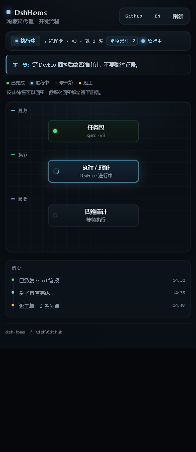

# 0.8.8 DshHoms 可视化界面：精密控制台

方向 A：在不改变流程结构、数据逻辑、工作区选择和语言切换的前提下，重做视觉层。



> 这是静态预览，不是实际 DSH 面板截图；实际内容由 `/dwguard/board` 数据驱动。

## 视觉决策

| 层 | 0.8.8 |
| --- | --- |
| 背景 | 近黑蓝底 + 顶部极淡冷光；流程画布加 24px 网格，强调“控制台”而不是普通卡片列表 |
| 容器 | 细边框、10–12px 圆角、内高光；不叠加大面积阴影 |
| 顶部 | 品牌方点 + 标题；工作区/语言/刷新合为一个 segmented 控件组 |
| 状态条 | phase 胶囊带语义点；工作区/版本/轮次用等宽字体；未读/运行中为独立 chip |
| 下一步 | 左侧 2px 强调线 + 冷光背景，作为唯一“行动提示” |
| 流程 | 节点保留原坐标与状态语义；done 绿、active 青、failed 琥珀、pending 低透明度 |
| 历史 | 卡片 + 时间线，时间戳等宽；种类用语义点区分 |
| 字体 | UI 无衬线；状态/路径/时间使用等宽字体 |
| 动效 | 当前节点呼吸光 + 活点脉冲；`prefers-reduced-motion` 全部关闭 |

## 主题 token

```text
bg          #080b10
surface     #0d131a
raised      #111a23
line        rgba(148,163,184,.15)
text        #e7edf4
muted       #8b98a8
faint       #718091
accent      #7dd3fc
ok          #4ade80
warn        #fbbf24
violet      #c4b5fd
```

## 未改变

- 工作区选择器的取值/切换逻辑；
- 中英文词典与 `localStorage` 记忆；
- 15s 自动刷新；
- 流程图节点坐标、阶段顺序和回环；
- 所有工具/审计逻辑。

## 验证

- `node --test tests/client.test.mjs`
- 全量 `npm test`
- 静态预览：`docs/assets/dshhoms-0.8.8.png`
